# The 2017 to 2026 series: the other 37 clearings over 10 acres

Every clearing over 10 acres that the random draw did not pick. 37 checks: 33 cleared, 4 partly cleared. Each picture shows the same ground before and after, with the detected outline in yellow. The verdict under it is the reviewer's (Adam Whitaker, the author). Verdicts as a table: [verify_log.csv](../verify_log.csv) and [verify_log_large_optional.csv](../verify_log_large_optional.csv).

Page 1 of 2: **1** · [2](page-02.md)

## D0010

26.5 acres · first detected 2017 Q4 · governing case: 13CZ30 ([private applicant])

**Verdict: Cleared**

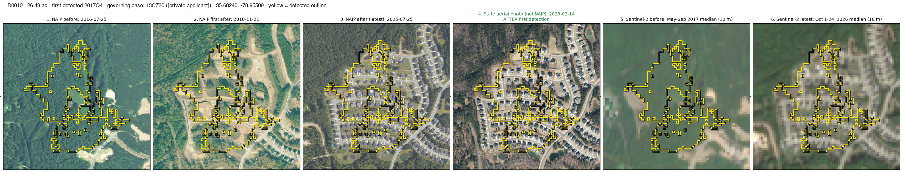

## D0047

10.2 acres · first detected 2017 Q4 · governing case: 15CZ18 (BENCHMARK COMM)

**Verdict: Cleared**

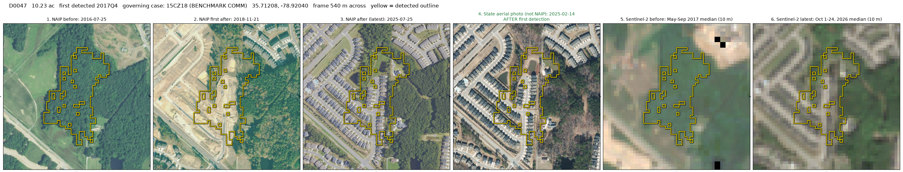

## D0017

20.1 acres · first detected 2018 Q3 · governing case: 25CZ18 (VERIDEA SD PLAN)

**Verdict: Cleared**. Reviewer's note: Cleared in 2018 and since regrown: trees in the 2016 NAIP (#1), fully cleared in the November 2018 NAIP (#2), tree cover again by 2025 (#3 to #6). Marked cleared because the detected clearing happened.

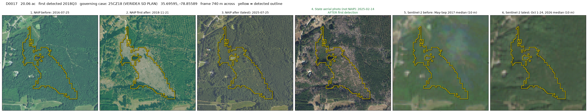

## D0040

11.4 acres · first detected 2018 Q2 · governing case: 16CZ26 (CRESCENT CMMNTS)

**Verdict: Cleared**

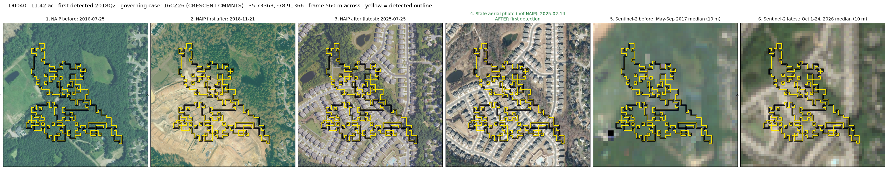

## D0008

31.4 acres · first detected 2020 Q2 · governing case: 01TRZ08 (TOWN OF APEX)

**Verdict: Cleared**

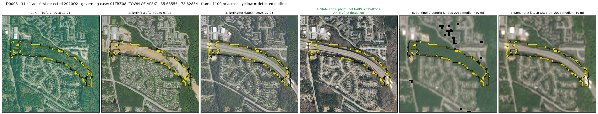

## D0012

24.3 acres · first detected 2020 Q1 · governing case: 15CZ33 (MCADAMS COMPANY)

**Verdict: Cleared**

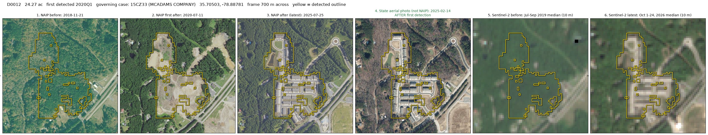

## D0021

18.5 acres · first detected 2020 Q1 · governing case: 15CZ33 (MCADAMS COMPANY)

**Verdict: Cleared**

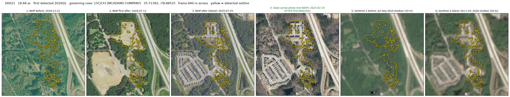

## D0030

14.7 acres · first detected 2020 Q1 · governing case: 01TRZ08 (TOWN OF APEX)

**Verdict: Cleared**

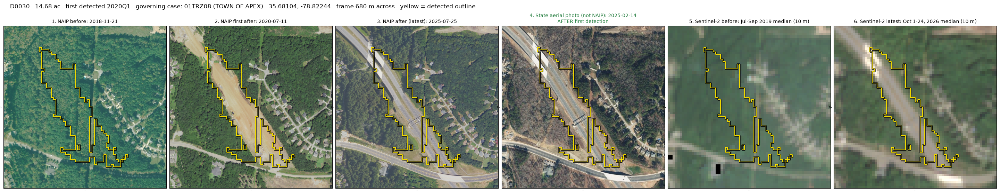

## D0042

11.3 acres · first detected 2020 Q2 · governing case: 07ETJ24 (TOWN OF APEX)

**Verdict: Cleared**

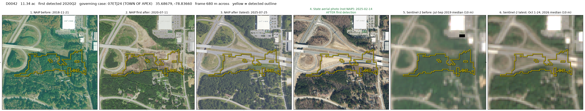

## D0014

21.9 acres · first detected 2021 Q2 · governing case: 18CZ02 (FRIENDSHIP STAT)

**Verdict: Cleared**

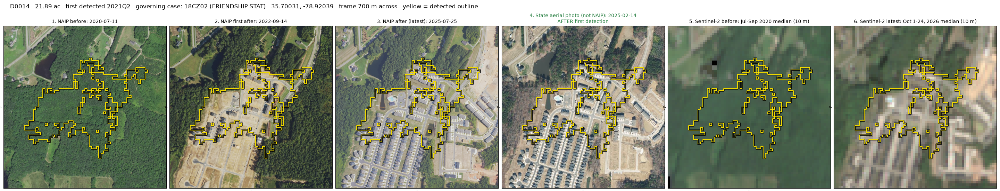

## D0020

18.7 acres · first detected 2021 Q3 · governing case: 15CZ32 ([private applicant])

**Verdict: Cleared**

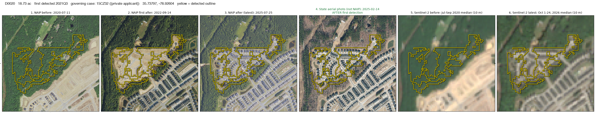

## D0031

14.6 acres · first detected 2021 Q3 · governing case: 21CZ08 (TOWN OF APEX)

**Verdict: Cleared**

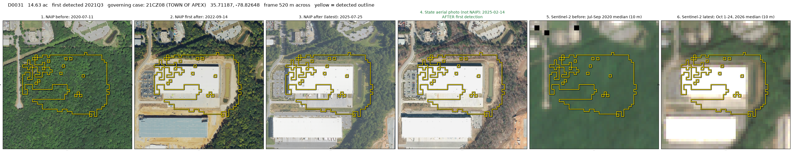

## D0043

11.0 acres · first detected 2021 Q2 · governing case: 16CZ26 (CRESCENT CMMNTS)

**Verdict: Cleared**

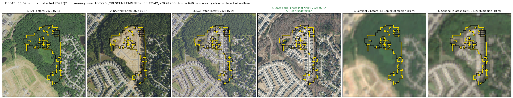

## D0046

10.4 acres · first detected 2021 Q3 · governing case: 18CZ02 (FRIENDSHIP STAT)

**Verdict: Cleared**

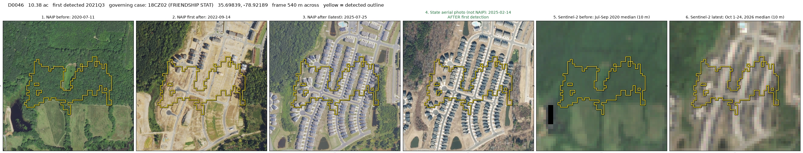

## D0003

45.8 acres · first detected 2022 Q1 · governing case: 20CZ01 (LENNAR)

**Verdict: Cleared**

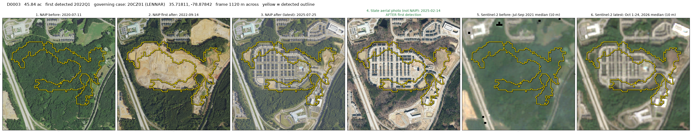

## D0029

14.8 acres · first detected 2023 Q2 · governing case: 21CZ16 (MORNINGSTAR LG)

**Verdict: Cleared**

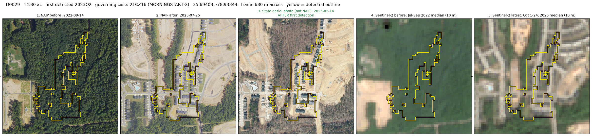

## D0032

13.0 acres · first detected 2023 Q4 · governing case: 24CZ23 (GREENWAY WASTE)

**Verdict: Cleared**

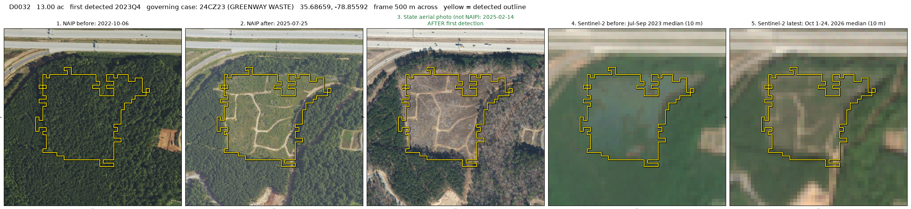

## D0034

12.6 acres · first detected 2023 Q3 · governing case: 18CZ02 (FRIENDSHIP STAT)

**Verdict: Cleared**

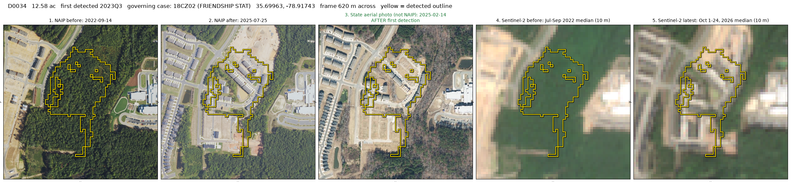

## D0035

12.6 acres · first detected 2023 Q3 · governing case: 18CZ04 (MFW INVESTMENTS)

**Verdict: Cleared**

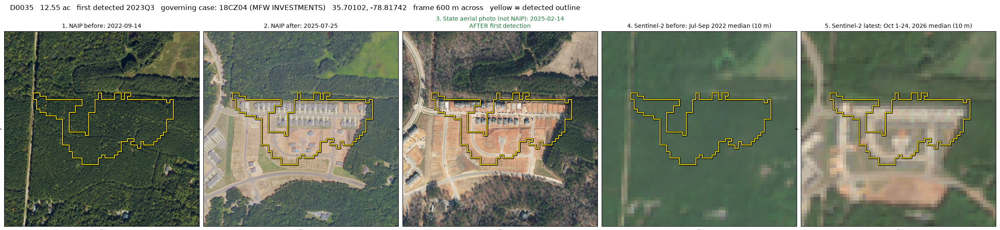

## D0048

10.1 acres · first detected 2023 Q1 · governing case: 18CZ04 (MFW INVESTMENTS)

**Verdict: Partly cleared** (about 95% of the outline cleared)

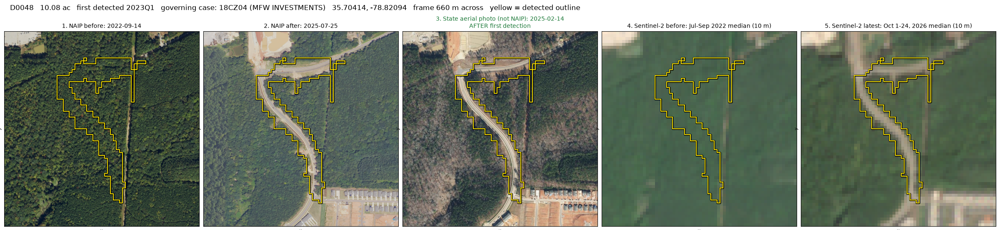

Page 1 of 2: **1** · [2](page-02.md)
