# The 2017 to 2026 series: the other 37 clearings over 10 acres

Every clearing over 10 acres that the random draw did not pick. 37 checks: 33 cleared, 4 partly cleared. Each picture shows the same ground before and after, with the detected outline in yellow. The verdict under it is the reviewer's (Adam Whitaker, the author). Verdicts as a table: [verify_log.csv](../verify_log.csv) and [verify_log_large_optional.csv](../verify_log_large_optional.csv).

Page 2 of 2: [1](README.md) · **2**

## D0013

22.8 acres · first detected 2024 Q2 · governing case: 20CZ01 (LENNAR)

**Verdict: Cleared**

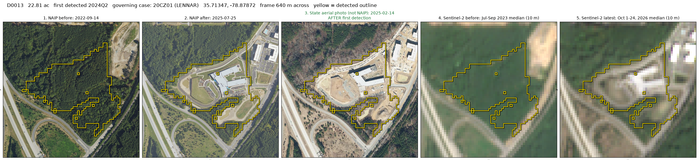

## D0025

16.8 acres · first detected 2024 Q2 · governing case: 21CZ16 (MORNINGSTAR LG)

**Verdict: Cleared**

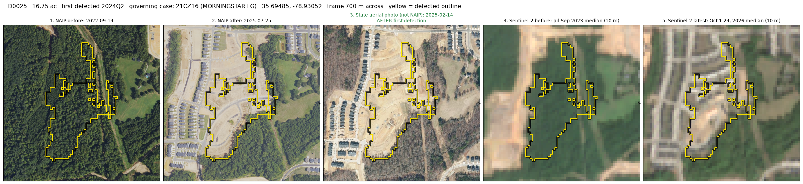

## D0004

45.3 acres · first detected 2025 Q3 · governing case: 25CZ18 (VERIDEA SD PLAN)

**Verdict: Cleared**

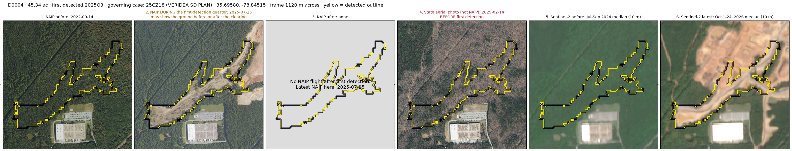

## D0005

38.1 acres · first detected 2025 Q1 · governing case: 25CZ18 (VERIDEA SD PLAN)

**Verdict: Cleared**

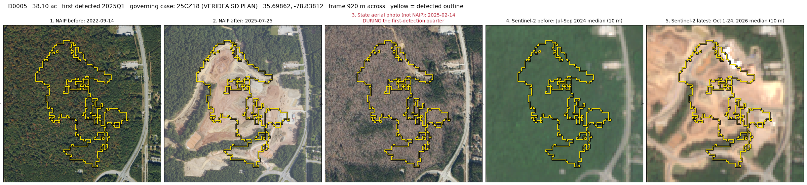

## D0009

29.4 acres · first detected 2025 Q2 · governing case: 25CZ18 (VERIDEA SD PLAN)

**Verdict: Cleared**

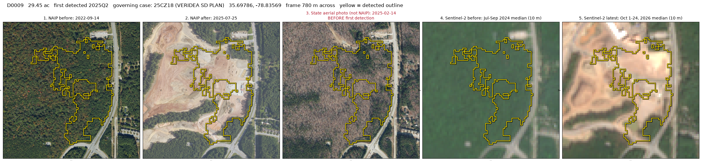

## D0016

21.0 acres · first detected 2025 Q1 · governing case: 22CZ09 (UTLEY FARMS PUD)

**Verdict: Partly cleared** (about 95% of the outline cleared)

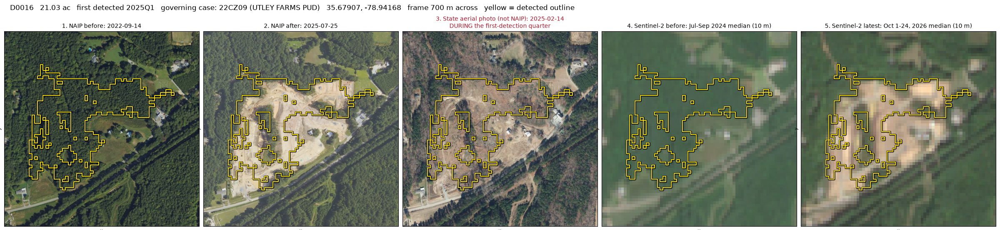

## D0018

19.5 acres · first detected 2025 Q4 · governing case: 25CZ18 (VERIDEA SD PLAN)

**Verdict: Cleared**

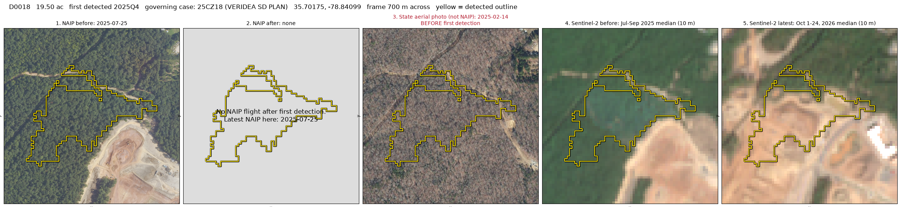

## D0022

18.1 acres · first detected 2025 Q1 · governing case: 17CZ19 (MFW INVESTMENTS)

**Verdict: Partly cleared** (about 95% of the outline cleared)

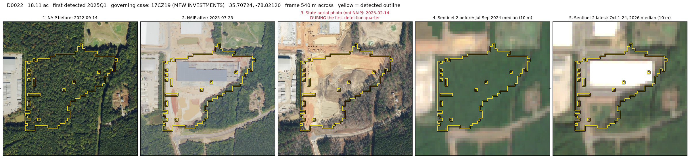

## D0024

16.9 acres · first detected 2025 Q4 · governing case: 07ETJ24 (TOWN OF APEX)

**Verdict: Cleared**

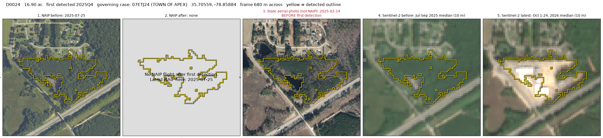

## D0027

15.8 acres · first detected 2025 Q1 · governing case: 14CZ16 (AQUILINE APEX)

**Verdict: Cleared**

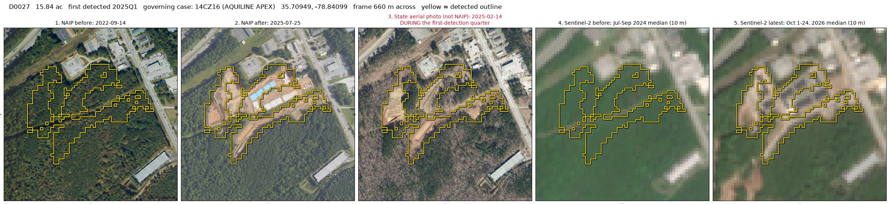

## D0028

15.5 acres · first detected 2025 Q3 · governing case: 22CZ22 (ELEVATE 64 WEST)

**Verdict: Cleared**

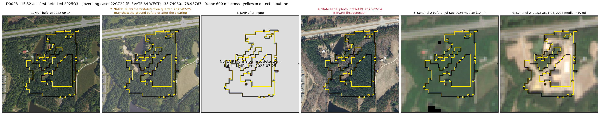

## D0036

12.5 acres · first detected 2025 Q2 · governing case: 25CZ18 (VERIDEA SD PLAN)

**Verdict: Partly cleared** (about 95% of the outline cleared)

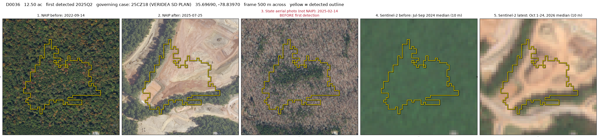

## D0045

10.4 acres · first detected 2025 Q3 · governing case: 26CZ03 (VERIDEA SD PLAN)

**Verdict: Cleared**

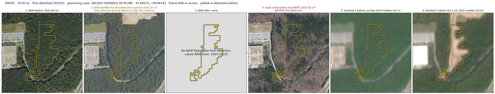

## D0049

10.1 acres · first detected 2025 Q1 · governing case: 21CZ14 (HOLLAND RD PUD)

**Verdict: Cleared**

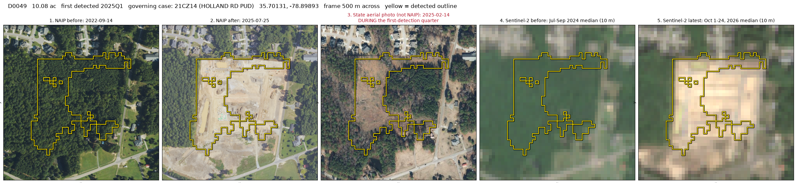

## D0015

21.6 acres · first detected 2026 Q3 · governing case: 23CZ15 (APEX GATEWAY PH2)

**Verdict: Cleared**

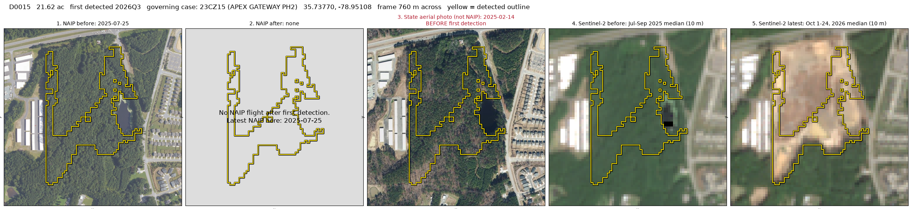

## D0026

16.7 acres · first detected 2026 Q4 · governing case: 23CZ15 (APEX GATEWAY PH2)

**Verdict: Cleared**

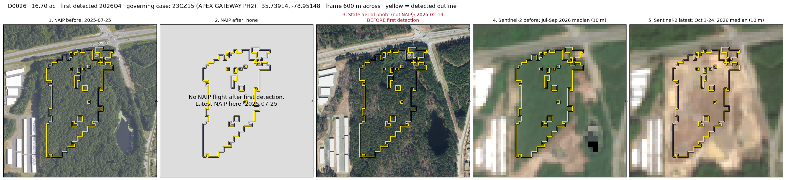

## D0041

11.4 acres · first detected 2026 Q4 · governing case: 21CZ12 (LEGACY PUD)

**Verdict: Cleared**

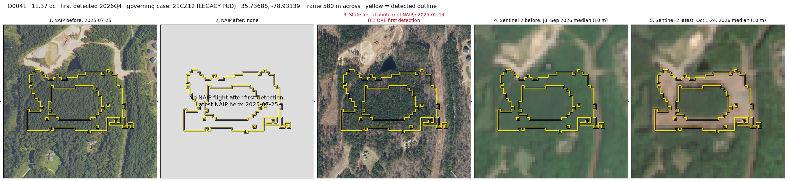

Page 2 of 2: [1](README.md) · **2**
