# The published count: all 238 clearings

Every clearing in the count of 929 acres published in fall 2026. 238 checks: 207 cleared, 31 partly cleared. Each picture shows the same ground before and after, with the detected outline in yellow. The verdict under it is the reviewer's (Adam Whitaker, the author). Verdicts as a table: [verify_log.csv](../verify_log.csv).

Page 1 of 12: **1** · [2](page-02.md) · [3](page-03.md) · [4](page-04.md) · [5](page-05.md) · [6](page-06.md) · [7](page-07.md) · [8](page-08.md) · [9](page-09.md) · [10](page-10.md) · [11](page-11.md) · [12](page-12.md)

## C001

45.0 acres · first detected 2023 Q2 · governing case: 20CZ12 (FELTON GROVE HS)

**Verdict: Cleared**

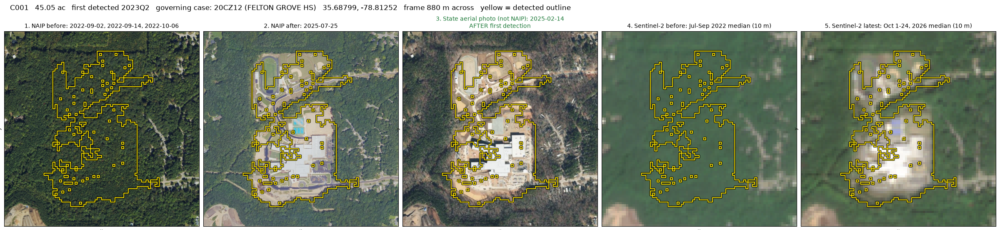

## C002

24.9 acres · first detected 2023 Q3 · governing case: 22CZ24 (APEX GATEWAY PH1)

**Verdict: Cleared**

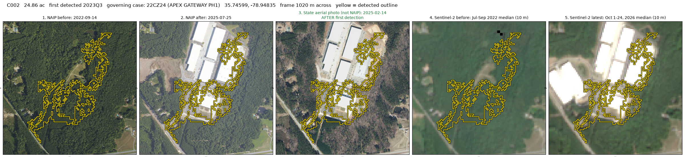

## C003

22.3 acres · first detected 2026 Q3 · governing case: 23CZ15 (Apex Gateway Phase 2 Amendment)

**Verdict: Cleared**

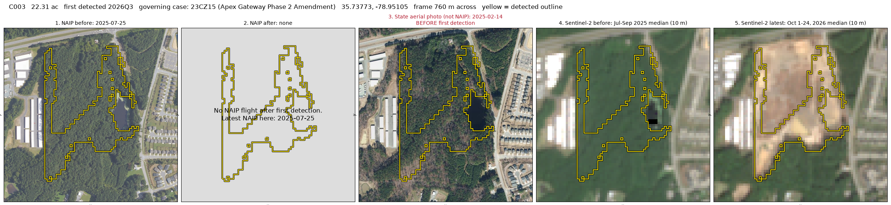

## C004

19.3 acres · first detected 2025 Q1 · governing case: 22CZ09 (UTLEY FARMS PUD)

**Verdict: Partly cleared** (about 95% of the outline cleared)

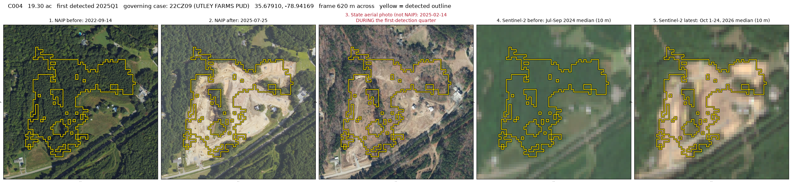

## C005

16.6 acres · first detected 2024 Q2 · governing case: 20CZ01 (LENNAR)

**Verdict: Cleared**

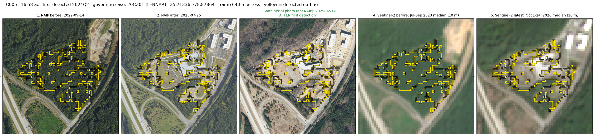

## C006

16.1 acres · first detected 2026 Q4 · governing case: 23CZ15 (Apex Gateway Phase 2 Amendment)

**Verdict: Cleared**

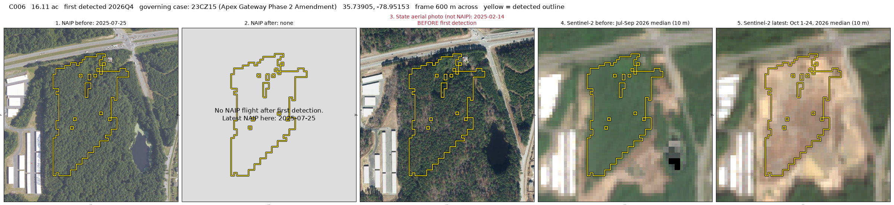

## C007

15.2 acres · first detected 2025 Q1 · governing case: 17CZ19 (MFW INVESTMENTS)

**Verdict: Cleared**

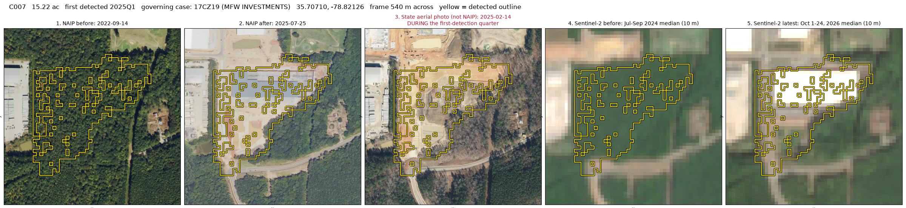

## C008

14.9 acres · first detected 2025 Q3 · governing case: 25CZ18 (Veridea SD Plan Amendment)

**Verdict: Cleared**

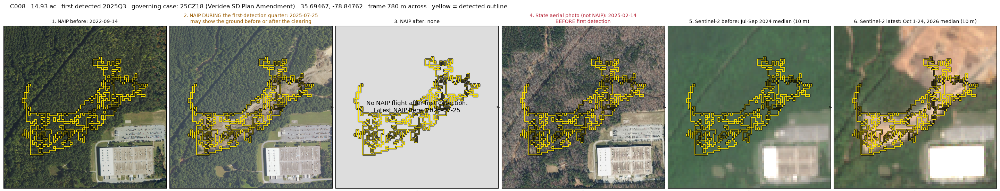

## C009

14.1 acres · first detected 2025 Q3 · governing case: 22CZ22 (Elevate 64)

**Verdict: Cleared**

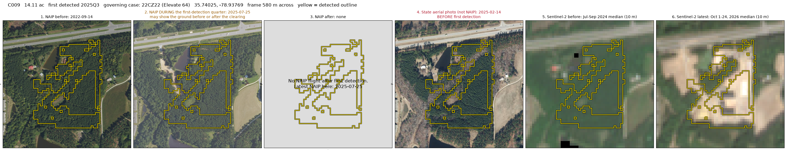

## C010

13.6 acres · first detected 2025 Q4 · governing case: 07ETJ24 (TOWN OF APEX)

**Verdict: Cleared**

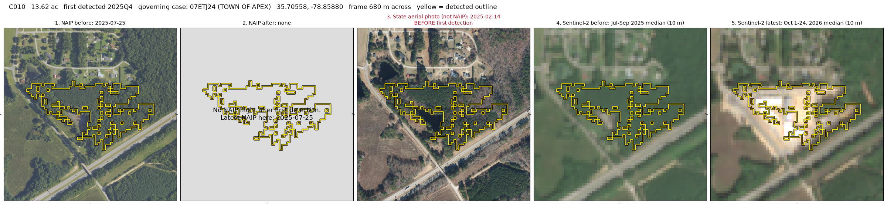

## C011

12.2 acres · first detected 2024 Q2 · governing case: 21CZ16 (MORNINGSTAR LG)

**Verdict: Cleared**

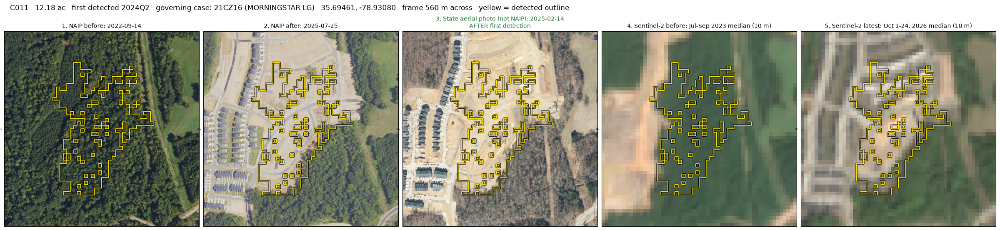

## C012

12.1 acres · first detected 2025 Q2 · governing case: 21CZ14 (HOLLAND RD PUD)

**Verdict: Cleared**

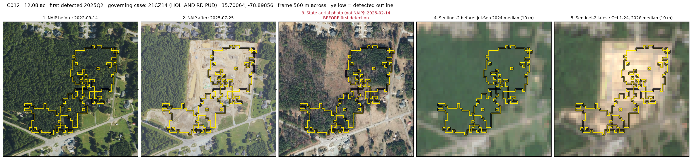

## C013

12.0 acres · first detected 2023 Q3 · governing case: 18CZ04 (Horton Park PUD Amendment)

**Verdict: Partly cleared** (about 95% of the outline cleared)

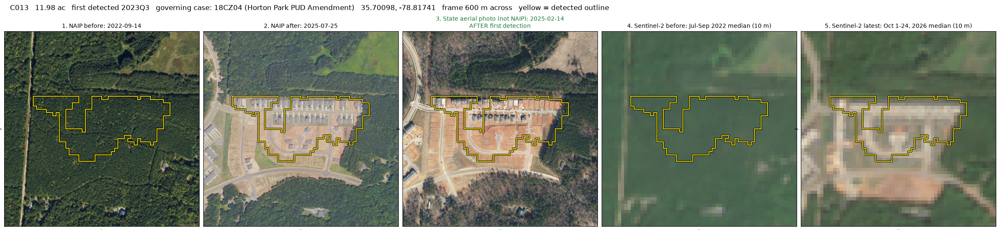

## C014

11.6 acres · first detected 2023 Q4 · governing case: 24CZ23 (Greenway Wates Solutions)

**Verdict: Cleared**

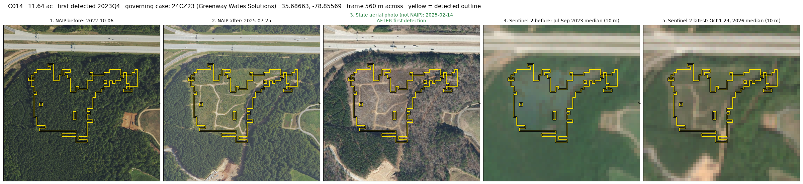

## C015

11.3 acres · first detected 2026 Q4 · governing case: 21CZ12 (LEGACY PUD)

**Verdict: Cleared**

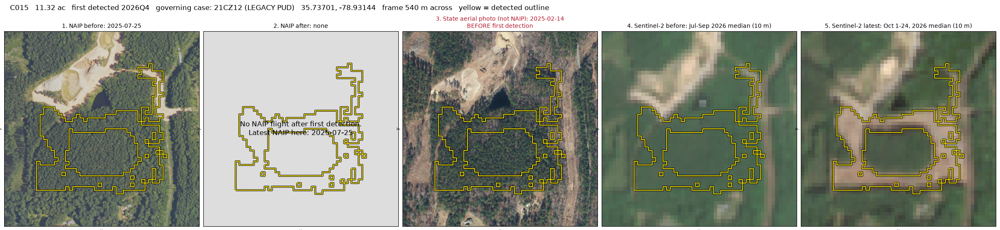

## C016

10.6 acres · first detected 2023 Q2 · governing case: 21CZ16 (MORNINGSTAR LG)

**Verdict: Cleared**

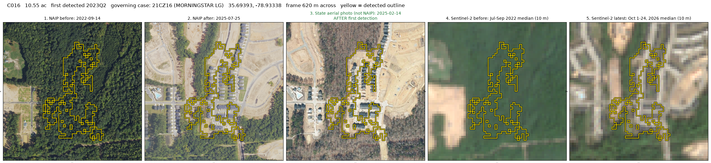

## C017

10.4 acres · first detected 2023 Q3 · governing case: 18CZ02 (Friendship Station PUD Amendment)

**Verdict: Cleared**

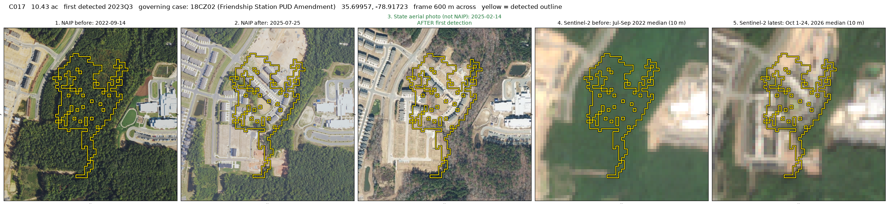

## C018

10.3 acres · first detected 2026 Q1 · governing case: 24CZ09 (CASTLEBERRY RESE)

**Verdict: Cleared**

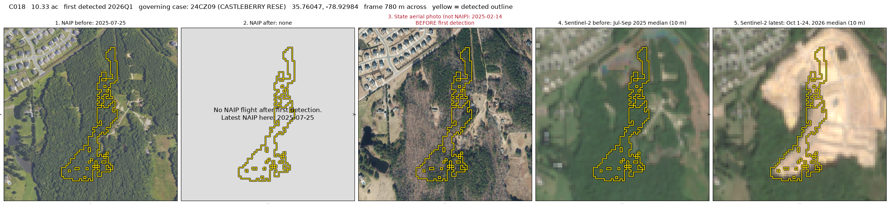

## C019

10.2 acres · first detected 2025 Q1 · governing case: 21CZ12 (LEGACY PUD)

**Verdict: Cleared**

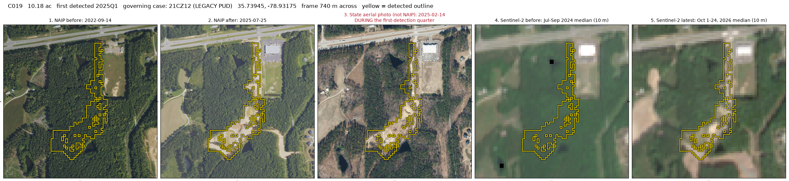

## C020

9.8 acres · first detected 2023 Q2 · governing case: 18CZ04 (Horton Park PUD Amendment)

**Verdict: Cleared**

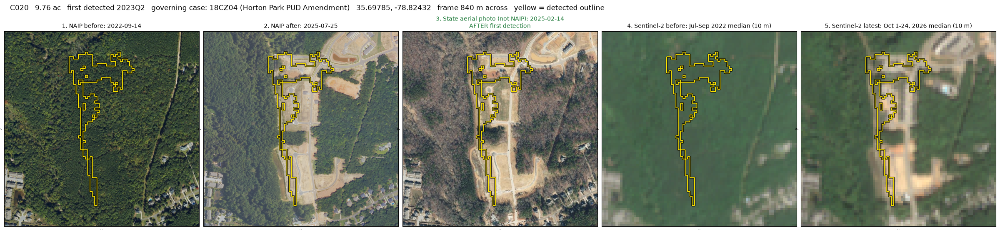

Page 1 of 12: **1** · [2](page-02.md) · [3](page-03.md) · [4](page-04.md) · [5](page-05.md) · [6](page-06.md) · [7](page-07.md) · [8](page-08.md) · [9](page-09.md) · [10](page-10.md) · [11](page-11.md) · [12](page-12.md)
