# The published count: all 238 clearings

Every clearing in the count of 929 acres published in fall 2026. 238 checks: 207 cleared, 31 partly cleared. Each picture shows the same ground before and after, with the detected outline in yellow. The verdict under it is the reviewer's (Adam Whitaker, the author). Verdicts as a table: [verify_log.csv](../verify_log.csv).

Page 3 of 12: [1](README.md) · [2](page-02.md) · **3** · [4](page-04.md) · [5](page-05.md) · [6](page-06.md) · [7](page-07.md) · [8](page-08.md) · [9](page-09.md) · [10](page-10.md) · [11](page-11.md) · [12](page-12.md)

## C041

6.1 acres · first detected 2026 Q1 · governing case: 25CZ18 (Veridea SD Plan Amendment)

**Verdict: Cleared**

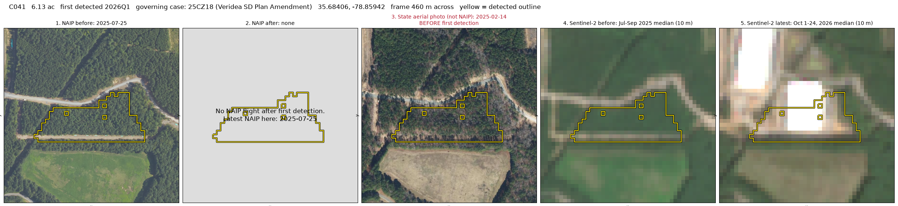

## C042

6.1 acres · first detected 2024 Q2 · governing case: 22CZ17 (TOWNES AT STATIO)

**Verdict: Cleared**

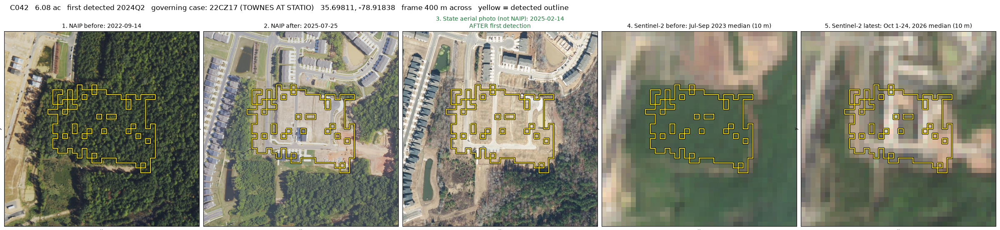

## C043

6.1 acres · first detected 2024 Q2 · governing case: 22CZ01 (ARDEN AT SUMMIT)

**Verdict: Cleared**

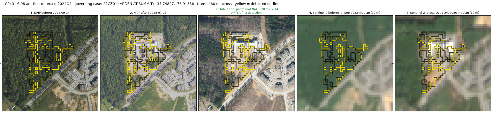

## C044

5.9 acres · first detected 2024 Q4 · governing case: 22CZ23 (YELLOWBRIDGE PUD)

**Verdict: Cleared**

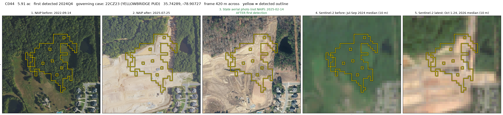

## C045

5.7 acres · first detected 2024 Q4 · governing case: 22CZ13 ([street address])

**Verdict: Cleared**

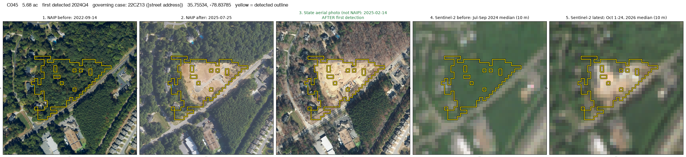

## C046

5.7 acres · first detected 2023 Q2 · governing case: 18CZ04 (Horton Park PUD Amendment)

**Verdict: Cleared**

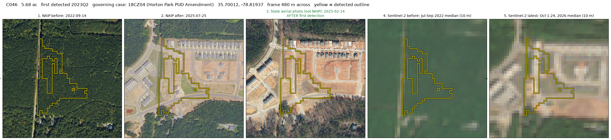

## C047

5.7 acres · first detected 2024 Q3 · governing case: 21CZ16 (MORNINGSTAR LG)

**Verdict: Cleared**

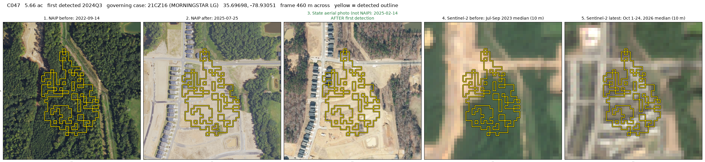

## C048

5.5 acres · first detected 2025 Q2 · governing case: 17CZ18 (GRACEWOOD PUD)

**Verdict: Partly cleared** (about 95% of the outline cleared)

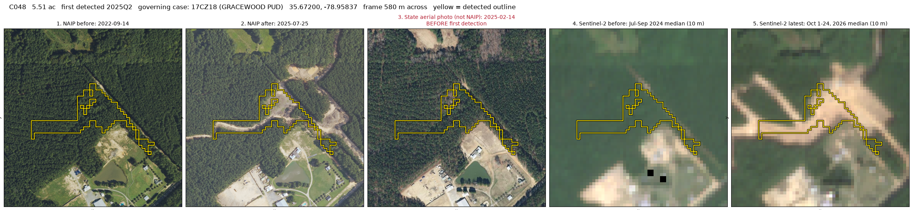

## C049

5.5 acres · first detected 2025 Q1 · governing case: 21CZ16 (MORNINGSTAR LG)

**Verdict: Cleared**

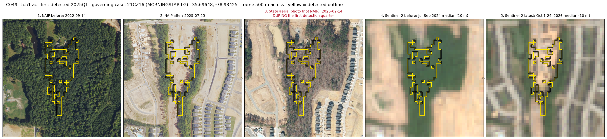

## C050

5.5 acres · first detected 2024 Q2 · governing case: 23CZ01 (CASH CORPORATE)

**Verdict: Cleared**

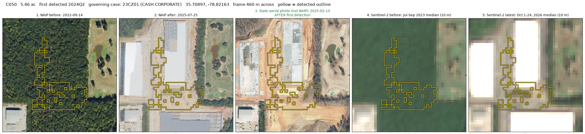

## C051

5.3 acres · first detected 2026 Q1 · governing case: 14CZ29 (APEX OLIVE, LLC)

**Verdict: Cleared**

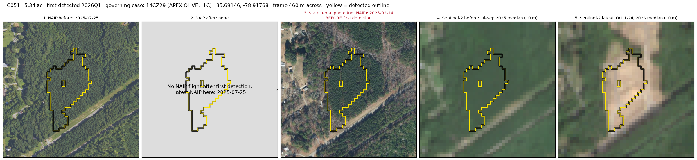

## C052

5.3 acres · first detected 2025 Q2 · governing case: 17CZ18 (GRACEWOOD PUD)

**Verdict: Cleared**

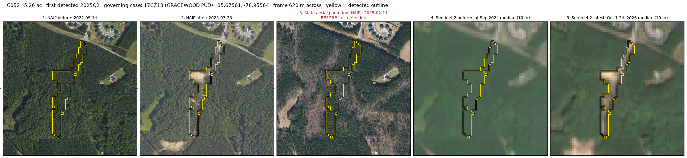

## C053

5.2 acres · first detected 2023 Q2 · governing case: 15CZ24 ([private applicant])

**Verdict: Partly cleared** (about 90% of the outline cleared)

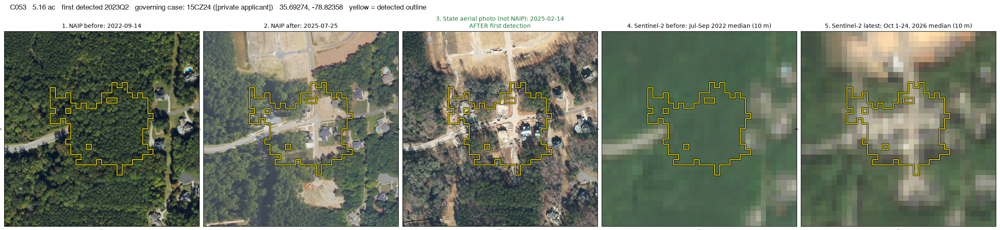

## C054

5.1 acres · first detected 2026 Q3 · governing case: 17CZ18 (GRACEWOOD PUD)

**Verdict: Cleared**

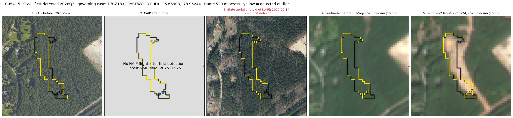

## C055

5.0 acres · first detected 2023 Q3 · governing case: 21CZ04 (WILLIAMS FARM PD)

**Verdict: Partly cleared** (about 95% of the outline cleared)

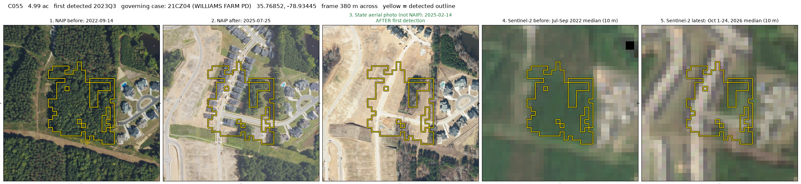

## C056

5.0 acres · first detected 2026 Q2 · governing case: 24CZ09 (CASTLEBERRY RESE)

**Verdict: Cleared**

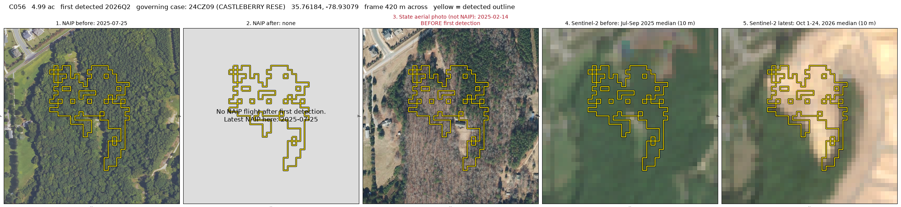

## C057

4.8 acres · first detected 2025 Q4 · governing case: 22CZ22 (Elevate 64)

**Verdict: Cleared**

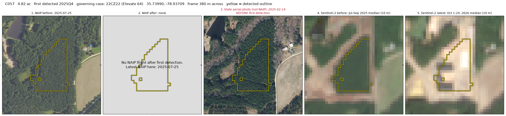

## C058

4.8 acres · first detected 2024 Q1 · governing case: 23CZ01 (CASH CORPORATE)

**Verdict: Cleared**

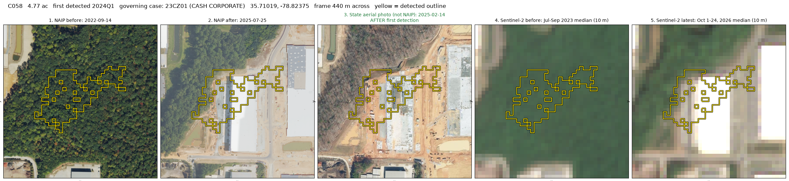

## C059

4.8 acres · first detected 2023 Q1 · governing case: 18CZ04 (Horton Park PUD Amendment)

**Verdict: Cleared**

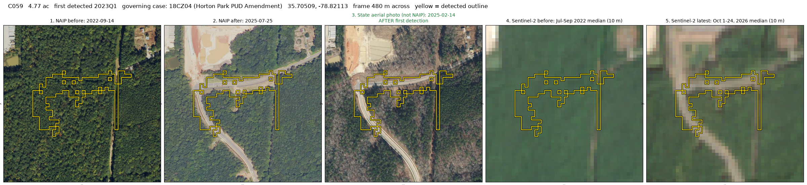

## C060

4.7 acres · first detected 2025 Q2 · governing case: 25CZ18 (Veridea SD Plan Amendment)

**Verdict: Cleared**

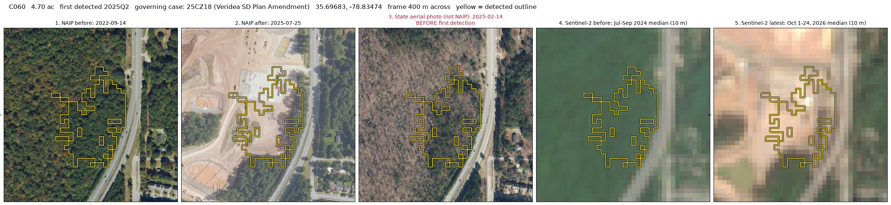

Page 3 of 12: [1](README.md) · [2](page-02.md) · **3** · [4](page-04.md) · [5](page-05.md) · [6](page-06.md) · [7](page-07.md) · [8](page-08.md) · [9](page-09.md) · [10](page-10.md) · [11](page-11.md) · [12](page-12.md)
