# The published count: all 238 clearings

Every clearing in the count of 929 acres published in fall 2026. 238 checks: 207 cleared, 31 partly cleared. Each picture shows the same ground before and after, with the detected outline in yellow. The verdict under it is the reviewer's (Adam Whitaker, the author). Verdicts as a table: [verify_log.csv](../verify_log.csv).

Page 4 of 12: [1](README.md) · [2](page-02.md) · [3](page-03.md) · **4** · [5](page-05.md) · [6](page-06.md) · [7](page-07.md) · [8](page-08.md) · [9](page-09.md) · [10](page-10.md) · [11](page-11.md) · [12](page-12.md)

## C061

4.7 acres · first detected 2023 Q3 · governing case: 20CZ14 (HACKNEY PUD)

**Verdict: Cleared**

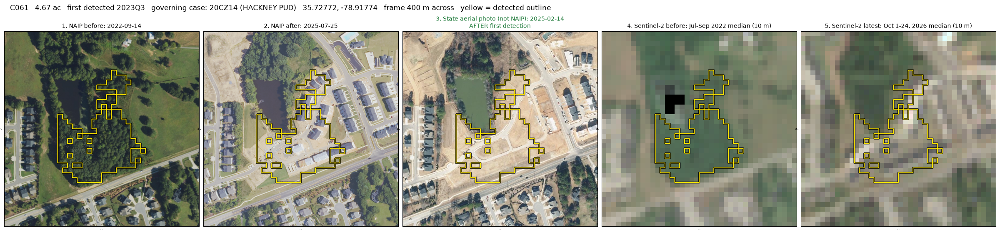

## C062

4.6 acres · first detected 2025 Q2 · governing case: 26CZ03 (Veridea SD-CZ Text Amendment)

**Verdict: Cleared**

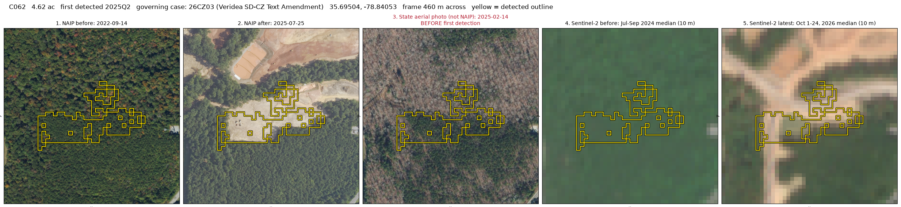

## C063

4.6 acres · first detected 2022 Q4 · governing case: 18CZ02 (Friendship Station PUD Amendment)

**Verdict: Partly cleared** (about 95% of the outline cleared)

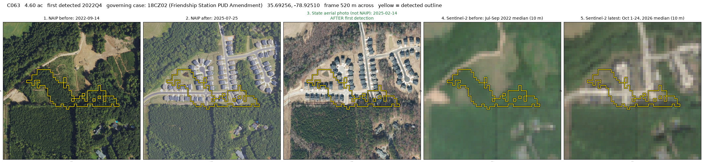

## C064

4.5 acres · first detected 2025 Q1 · governing case: 14CZ16 (AQUILINE APEX)

**Verdict: Partly cleared** (about 95% of the outline cleared)

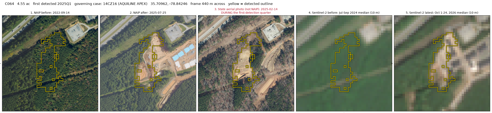

## C065

4.4 acres · first detected 2025 Q4 · governing case: 22CZ21 (APEX LIGHT INDUS)

**Verdict: Cleared**

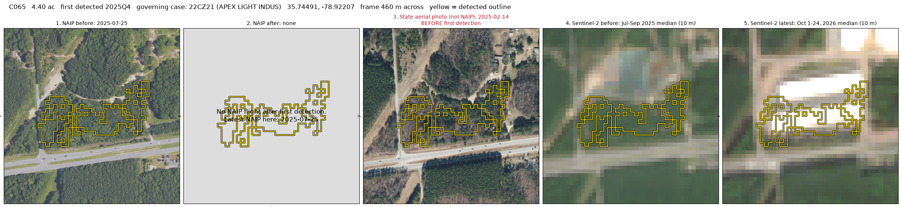

## C066

4.3 acres · first detected 2025 Q2 · governing case: 18CZ02 (Friendship Station PUD Amendment)

**Verdict: Cleared**

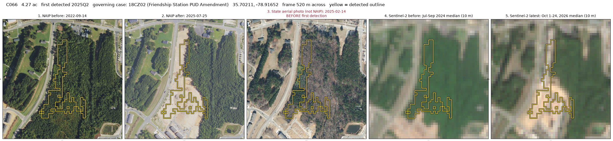

## C067

4.2 acres · first detected 2025 Q3 · governing case: 22CZ21 (APEX LIGHT INDUS)

**Verdict: Cleared**

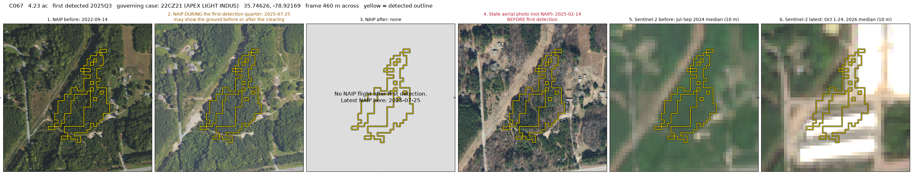

## C068

4.1 acres · first detected 2025 Q2 · governing case: 24CZ23 (Greenway Wates Solutions)

**Verdict: Partly cleared** (about 90% of the outline cleared)

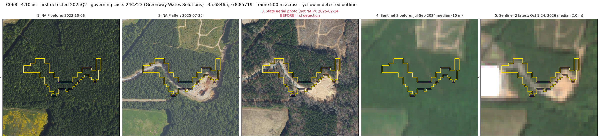

## C069

4.0 acres · first detected 2023 Q1 · governing case: 20CZ12 (FELTON GROVE HS)

**Verdict: Cleared**

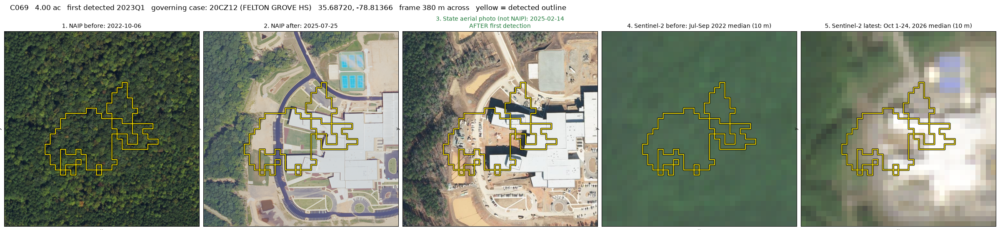

## C070

3.9 acres · first detected 2026 Q1 · governing case: 24CZ09 (CASTLEBERRY RESE)

**Verdict: Cleared**

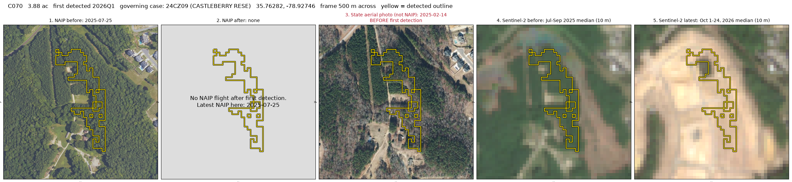

## C071

3.9 acres · first detected 2025 Q2 · governing case: 21CZ16 (MORNINGSTAR LG)

**Verdict: Cleared**

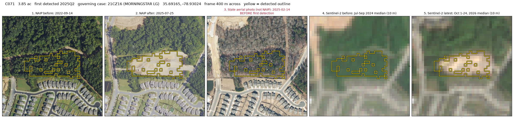

## C072

3.8 acres · first detected 2024 Q2 · governing case: 18CZ04 (Horton Park PUD Amendment)

**Verdict: Partly cleared** (about 95% of the outline cleared)

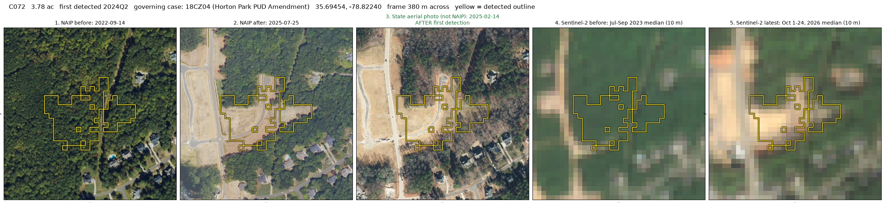

## C073

3.8 acres · first detected 2023 Q1 · governing case: 18CZ04 (Horton Park PUD Amendment)

**Verdict: Cleared**

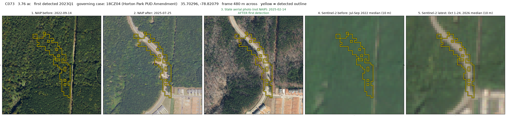

## C074

3.8 acres · first detected 2023 Q4 · governing case: 22CZ24 (APEX GATEWAY PH1)

**Verdict: Cleared**

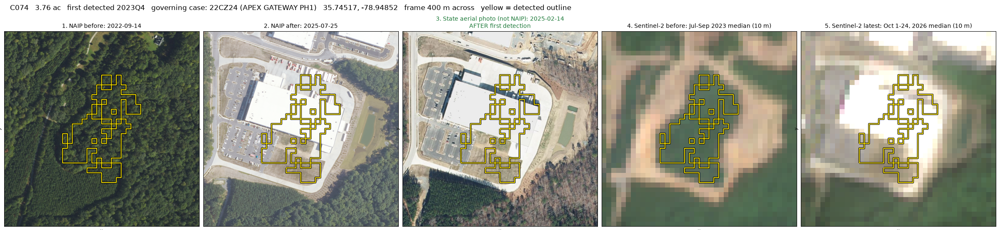

## C075

3.7 acres · first detected 2024 Q2 · governing case: 23CZ01 (CASH CORPORATE)

**Verdict: Cleared**

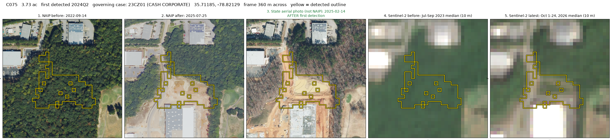

## C076

3.7 acres · first detected 2024 Q2 · governing case: 21CZ13 (EVANS ROAD PUD)

**Verdict: Partly cleared** (about 95% of the outline cleared)

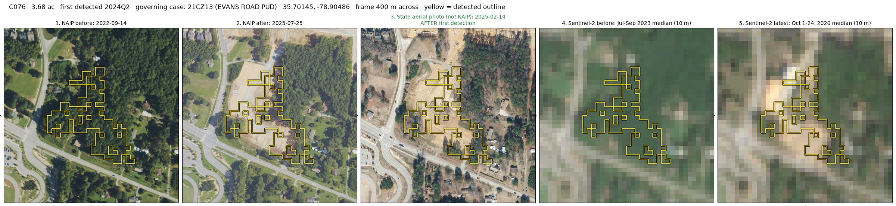

## C077

3.6 acres · first detected 2026 Q3 · governing case: 25CZ18 (Veridea SD Plan Amendment)

**Verdict: Cleared**

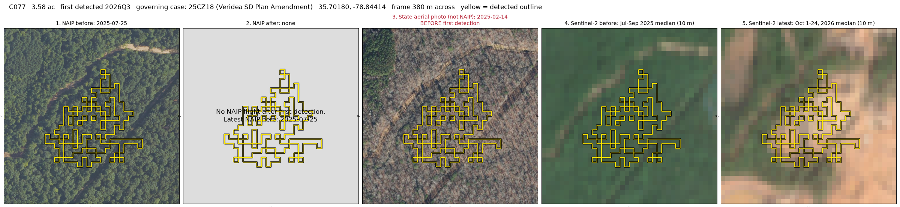

## C078

3.5 acres · first detected 2024 Q4 · governing case: 07CZ25 (CJS APEX)

**Verdict: Cleared**

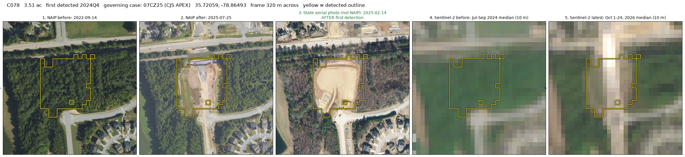

## C079

3.4 acres · first detected 2024 Q4 · governing case: 22CZ23 (YELLOWBRIDGE PUD)

**Verdict: Cleared**

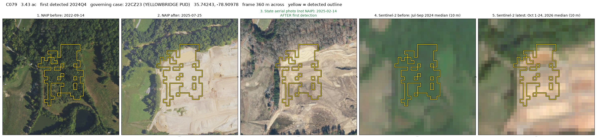

## C080

3.4 acres · first detected 2025 Q4 · governing case: 25CZ18 (Veridea SD Plan Amendment)

**Verdict: Cleared**

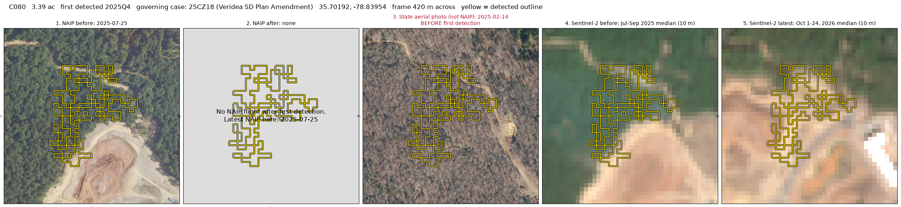

Page 4 of 12: [1](README.md) · [2](page-02.md) · [3](page-03.md) · **4** · [5](page-05.md) · [6](page-06.md) · [7](page-07.md) · [8](page-08.md) · [9](page-09.md) · [10](page-10.md) · [11](page-11.md) · [12](page-12.md)
