# The published count: all 238 clearings

Every clearing in the count of 929 acres published in fall 2026. 238 checks: 207 cleared, 31 partly cleared. Each picture shows the same ground before and after, with the detected outline in yellow. The verdict under it is the reviewer's (Adam Whitaker, the author). Verdicts as a table: [verify_log.csv](../verify_log.csv).

Page 6 of 12: [1](README.md) · [2](page-02.md) · [3](page-03.md) · [4](page-04.md) · [5](page-05.md) · **6** · [7](page-07.md) · [8](page-08.md) · [9](page-09.md) · [10](page-10.md) · [11](page-11.md) · [12](page-12.md)

## C101

2.4 acres · first detected 2026 Q3 · governing case: 17CZ18 (GRACEWOOD PUD)

**Verdict: Cleared**

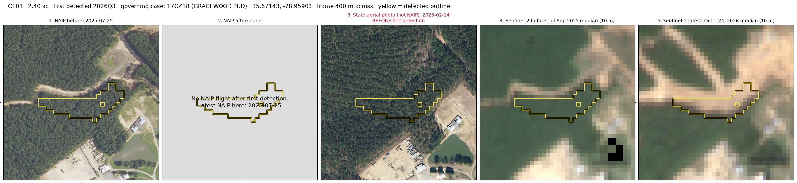

## C102

2.4 acres · first detected 2025 Q3 · governing case: 25CZ18 (Veridea SD Plan Amendment)

**Verdict: Partly cleared** (about 95% of the outline cleared)

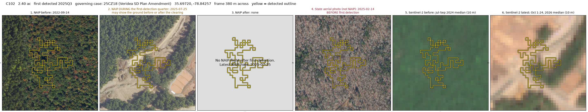

## C103

2.4 acres · first detected 2023 Q3 · governing case: 21CZ16 (MORNINGSTAR LG)

**Verdict: Cleared**

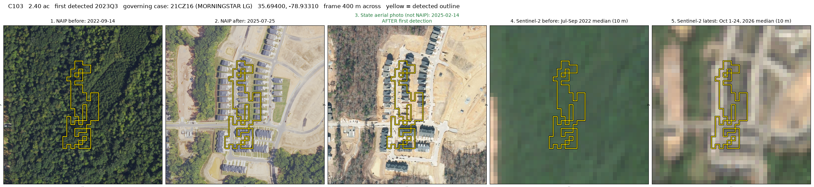

## C104

2.4 acres · first detected 2024 Q1 · governing case: 18CZ04 (Horton Park PUD Amendment)

**Verdict: Cleared**

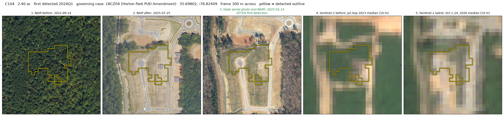

## C105

2.4 acres · first detected 2024 Q2 · governing case: 18CZ04 (Horton Park PUD Amendment)

**Verdict: Cleared**

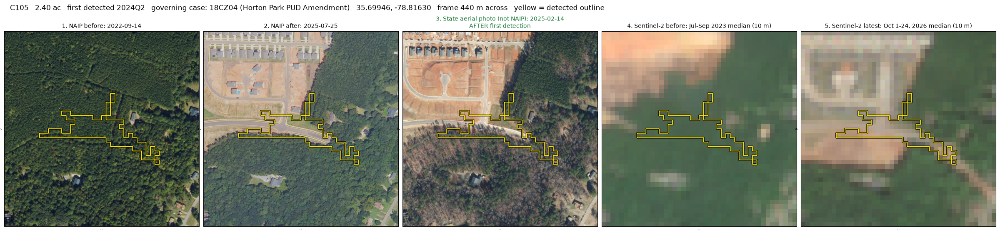

## C106

2.4 acres · first detected 2025 Q4 · governing case: 23CZ15 (Apex Gateway Phase 2 Amendment)

**Verdict: Cleared**

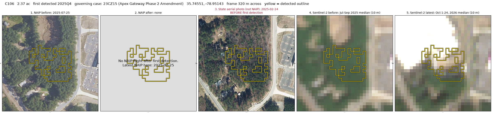

## C107

2.3 acres · first detected 2023 Q1 · governing case: 18CZ04 (Horton Park PUD Amendment)

**Verdict: Cleared**

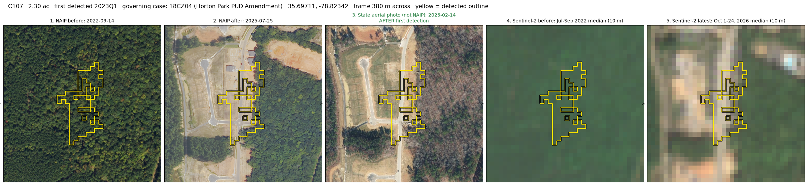

## C108

2.3 acres · first detected 2026 Q3 · governing case: 25CZ18 (Veridea SD Plan Amendment)

**Verdict: Cleared**

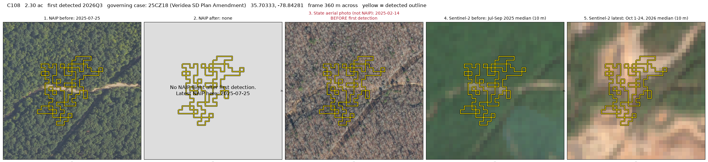

## C109

2.2 acres · first detected 2025 Q3 · governing case: 25CZ18 (Veridea SD Plan Amendment)

**Verdict: Partly cleared** (about 95% of the outline cleared)

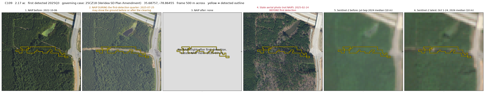

## C110

2.2 acres · first detected 2025 Q3 · governing case: 23CZ09 (HATCHER PROPERTY)

**Verdict: Cleared**

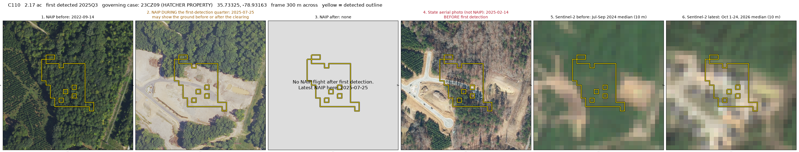

## C111

2.1 acres · first detected 2025 Q3 · governing case: 25CZ18 (Veridea SD Plan Amendment)

**Verdict: Cleared**

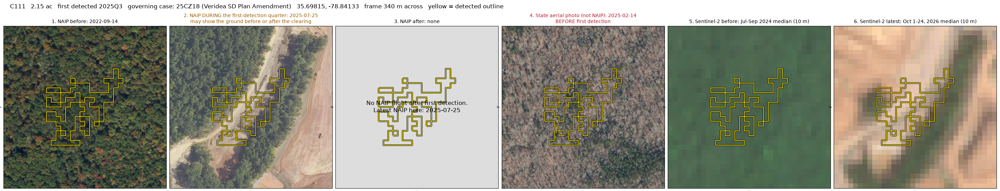

## C112

2.1 acres · first detected 2025 Q4 · governing case: 25CZ18 (Veridea SD Plan Amendment)

**Verdict: Cleared**

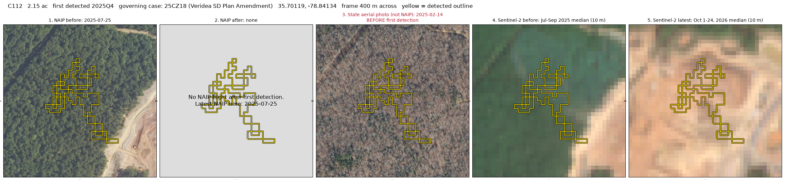

## C113

2.1 acres · first detected 2023 Q2 · governing case: 21CZ04 (WILLIAMS FARM PD)

**Verdict: Cleared**

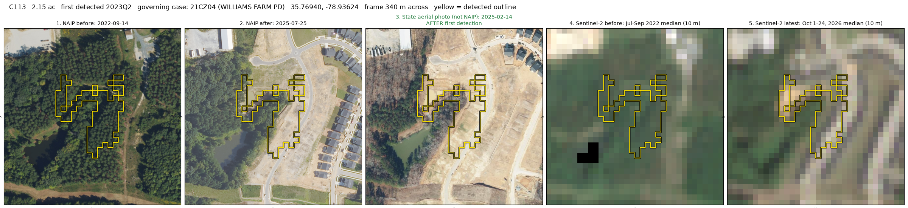

## C114

2.1 acres · first detected 2024 Q2 · governing case: 21CZ13 (EVANS ROAD PUD)

**Verdict: Cleared**

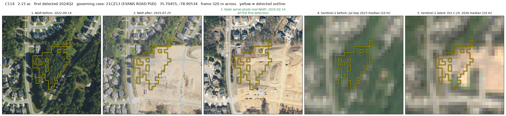

## C115

2.1 acres · first detected 2023 Q2 · governing case: 18CZ04 (Horton Park PUD Amendment)

**Verdict: Cleared**

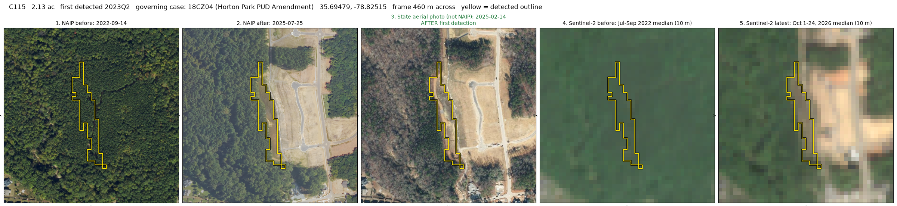

## C116

2.1 acres · first detected 2025 Q4 · governing case: 22CZ22 (Elevate 64)

**Verdict: Cleared**

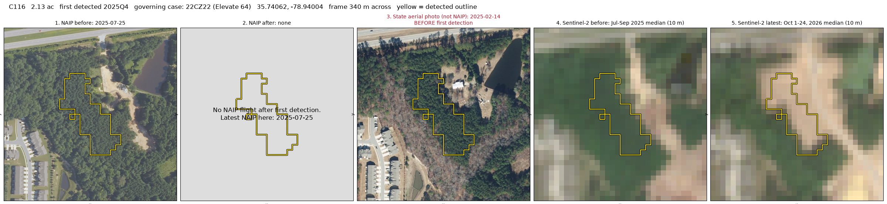

## C117

2.1 acres · first detected 2023 Q3 · governing case: 01TRZ08 (TOWN OF APEX)

**Verdict: Cleared**

*Picture held back: the clearing sits mostly on one home lot.*

## C118

2.1 acres · first detected 2025 Q4 · governing case: 25CZ18 (Veridea SD Plan Amendment)

**Verdict: Cleared**

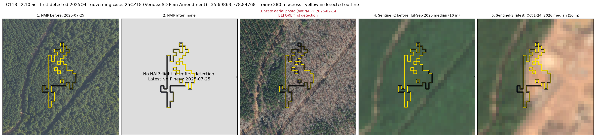

## C119

2.1 acres · first detected 2025 Q3 · governing case: 14CZ30 ([private applicant])

**Verdict: Cleared**

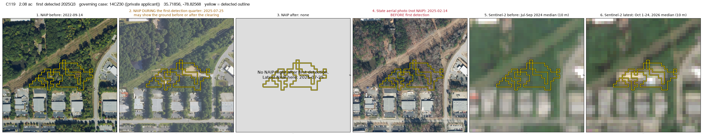

## C120

2.0 acres · first detected 2024 Q4 · governing case: 25CZ18 (Veridea SD Plan Amendment)

**Verdict: Cleared**

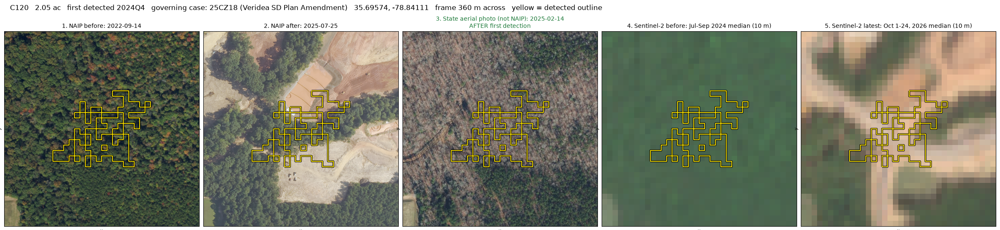

Page 6 of 12: [1](README.md) · [2](page-02.md) · [3](page-03.md) · [4](page-04.md) · [5](page-05.md) · **6** · [7](page-07.md) · [8](page-08.md) · [9](page-09.md) · [10](page-10.md) · [11](page-11.md) · [12](page-12.md)
