# The published count: all 238 clearings

Every clearing in the count of 929 acres published in fall 2026. 238 checks: 207 cleared, 31 partly cleared. Each picture shows the same ground before and after, with the detected outline in yellow. The verdict under it is the reviewer's (Adam Whitaker, the author). Verdicts as a table: [verify_log.csv](../verify_log.csv).

Page 7 of 12: [1](README.md) · [2](page-02.md) · [3](page-03.md) · [4](page-04.md) · [5](page-05.md) · [6](page-06.md) · **7** · [8](page-08.md) · [9](page-09.md) · [10](page-10.md) · [11](page-11.md) · [12](page-12.md)

## C121

2.0 acres · first detected 2025 Q2 · governing case: 17CZ18 (GRACEWOOD PUD)

**Verdict: Partly cleared** (about 95% of the outline cleared)

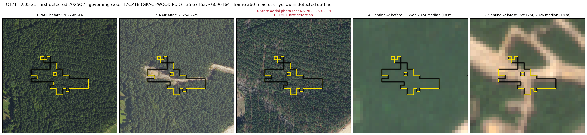

## C122

2.0 acres · first detected 2023 Q3 · governing case: 20CZ14 (HACKNEY PUD)

**Verdict: Cleared**

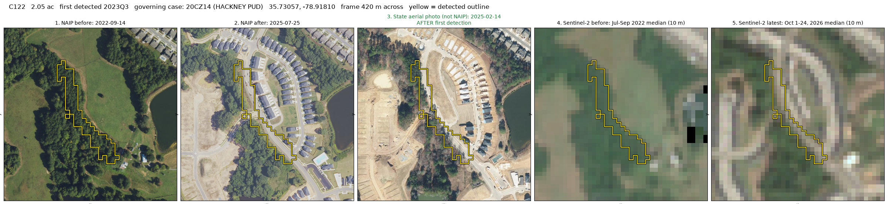

## C123

2.0 acres · first detected 2025 Q1 · governing case: 22CZ23 (YELLOWBRIDGE PUD)

**Verdict: Cleared**

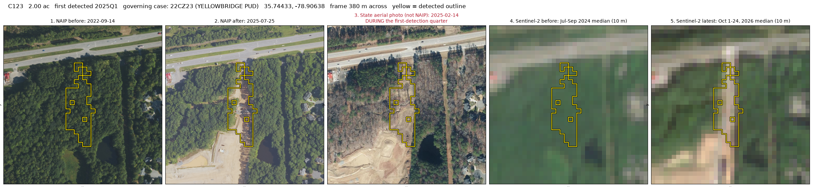

## C124

2.0 acres · first detected 2025 Q2 · governing case: 14CZ16 (AQUILINE APEX)

**Verdict: Cleared**

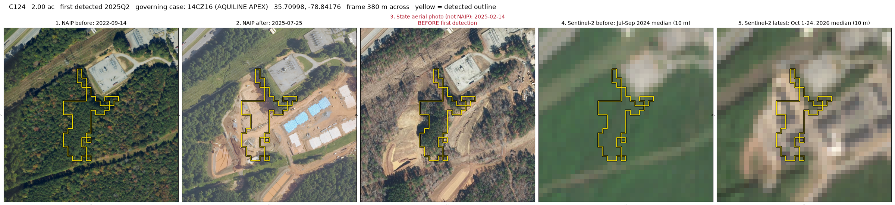

## C125

2.0 acres · first detected 2025 Q2 · governing case: 21CZ16 (MORNINGSTAR LG)

**Verdict: Cleared**

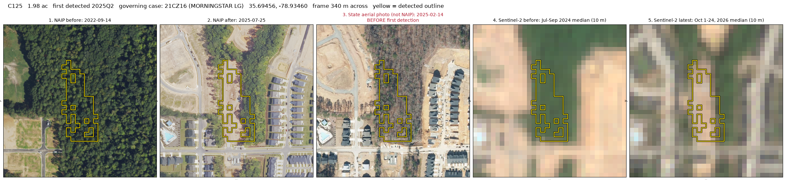

## C126

2.0 acres · first detected 2023 Q1 · governing case: no case

**Verdict: Cleared**

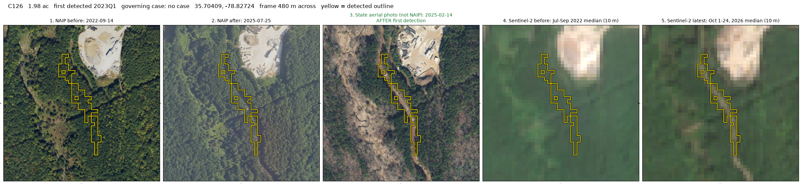

## C127

1.9 acres · first detected 2024 Q2 · governing case: 23CZ01 (CASH CORPORATE)

**Verdict: Cleared**

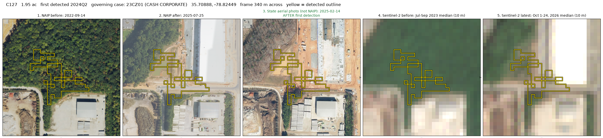

## C128

1.9 acres · first detected 2025 Q4 · governing case: 25CZ18 (Veridea SD Plan Amendment)

**Verdict: Cleared**

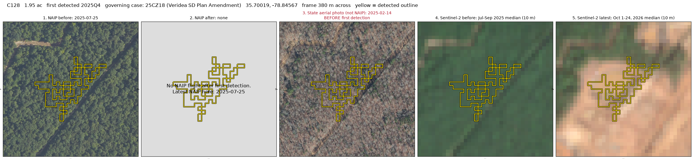

## C129

1.9 acres · first detected 2026 Q2 · governing case: 24CZ09 (CASTLEBERRY RESE)

**Verdict: Cleared**

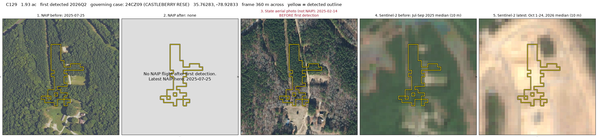

## C130

1.9 acres · first detected 2026 Q4 · governing case: 18CZ04 (Horton Park PUD Amendment)

**Verdict: Cleared**

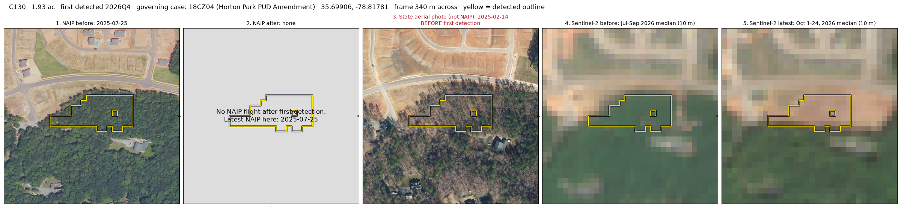

## C131

1.9 acres · first detected 2023 Q4 · governing case: 22CZ24 (APEX GATEWAY PH1)

**Verdict: Cleared**

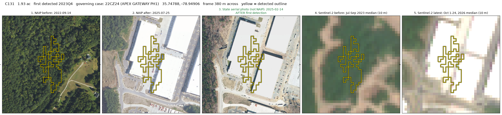

## C132

1.9 acres · first detected 2025 Q4 · governing case: 25CZ18 (Veridea SD Plan Amendment)

**Verdict: Cleared**

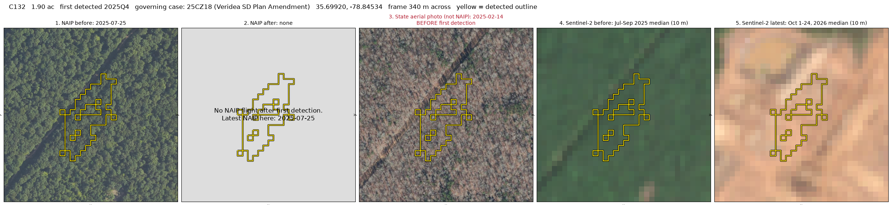

## C133

1.9 acres · first detected 2023 Q4 · governing case: 22CZ24 (APEX GATEWAY PH1)

**Verdict: Cleared**

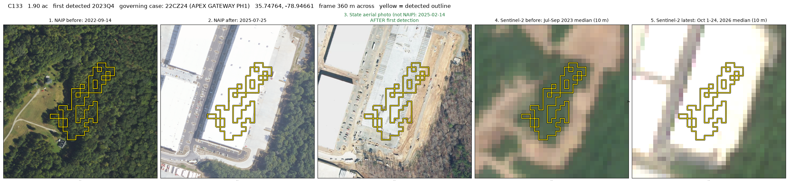

## C134

1.9 acres · first detected 2023 Q4 · governing case: 18CZ04 (Horton Park PUD Amendment)

**Verdict: Cleared**

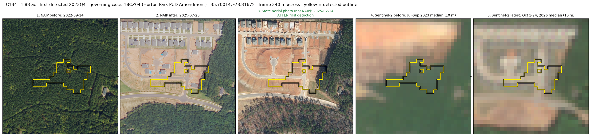

## C135

1.9 acres · first detected 2025 Q1 · governing case: 21CZ16 (MORNINGSTAR LG)

**Verdict: Cleared**

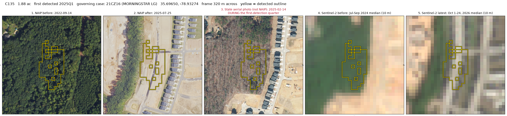

## C136

1.9 acres · first detected 2025 Q2 · governing case: 21CZ16 (MORNINGSTAR LG)

**Verdict: Cleared**

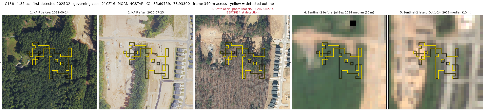

## C137

1.9 acres · first detected 2023 Q4 · governing case: 20CZ09 (PEAK ENGINEERING)

**Verdict: Cleared**

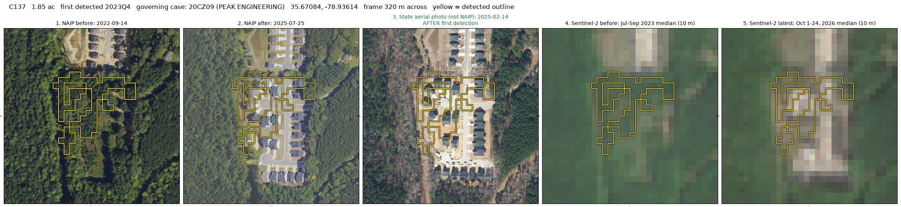

## C138

1.9 acres · first detected 2023 Q4 · governing case: 21CZ32 (CHAPEL RIDGE PUD)

**Verdict: Cleared**

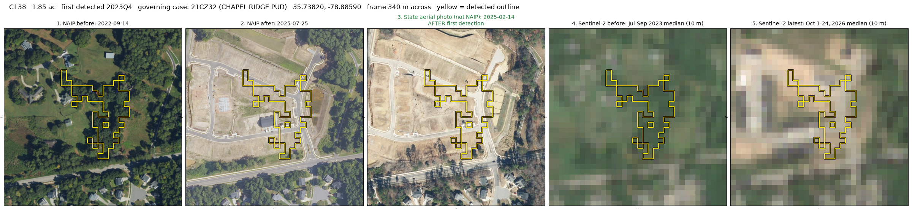

## C139

1.8 acres · first detected 2024 Q2 · governing case: 21CZ13 (EVANS ROAD PUD)

**Verdict: Partly cleared** (about 95% of the outline cleared)

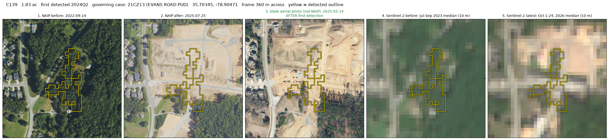

## C140

1.8 acres · first detected 2026 Q2 · governing case: 25CZ18 (Veridea SD Plan Amendment)

**Verdict: Cleared**

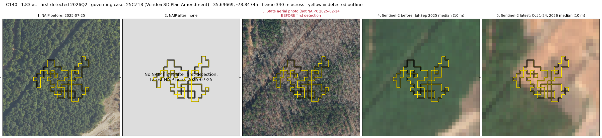

Page 7 of 12: [1](README.md) · [2](page-02.md) · [3](page-03.md) · [4](page-04.md) · [5](page-05.md) · [6](page-06.md) · **7** · [8](page-08.md) · [9](page-09.md) · [10](page-10.md) · [11](page-11.md) · [12](page-12.md)
