# The published count: all 238 clearings

Every clearing in the count of 929 acres published in fall 2026. 238 checks: 207 cleared, 31 partly cleared. Each picture shows the same ground before and after, with the detected outline in yellow. The verdict under it is the reviewer's (Adam Whitaker, the author). Verdicts as a table: [verify_log.csv](../verify_log.csv).

Page 10 of 12: [1](README.md) · [2](page-02.md) · [3](page-03.md) · [4](page-04.md) · [5](page-05.md) · [6](page-06.md) · [7](page-07.md) · [8](page-08.md) · [9](page-09.md) · **10** · [11](page-11.md) · [12](page-12.md)

## C181

1.4 acres · first detected 2025 Q1 · governing case: 22CZ23 (YELLOWBRIDGE PUD)

**Verdict: Cleared**

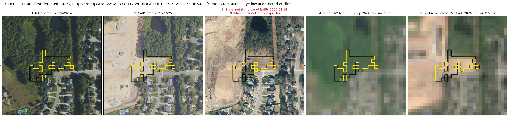

## C182

1.4 acres · first detected 2025 Q3 · governing case: 17CZ18 (GRACEWOOD PUD)

**Verdict: Partly cleared** (about 90% of the outline cleared)

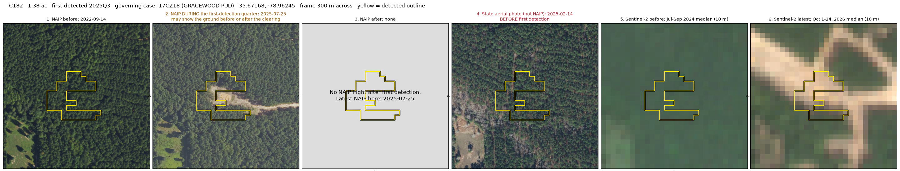

## C183

1.4 acres · first detected 2024 Q4 · governing case: 24CZ23 (Greenway Wates Solutions)

**Verdict: Cleared**

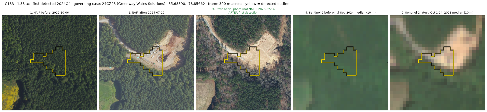

## C184

1.4 acres · first detected 2026 Q3 · governing case: 25CZ18 (Veridea SD Plan Amendment)

**Verdict: Cleared**

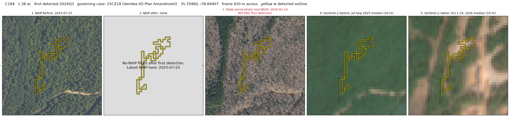

## C185

1.4 acres · first detected 2024 Q1 · governing case: 23CZ01 (CASH CORPORATE)

**Verdict: Cleared**

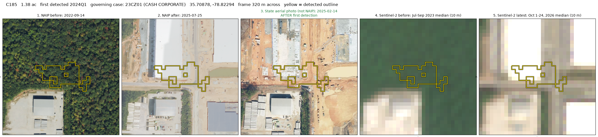

## C186

1.4 acres · first detected 2026 Q4 · governing case: 1963

**Verdict: Cleared**

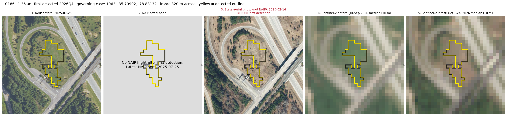

## C187

1.4 acres · first detected 2025 Q2 · governing case: 14CZ16 (AQUILINE APEX)

**Verdict: Cleared**

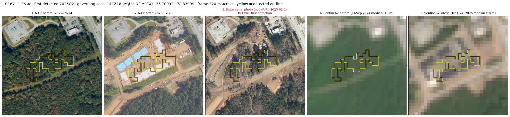

## C188

1.4 acres · first detected 2023 Q2 · governing case: 18CZ04 (Horton Park PUD Amendment)

**Verdict: Cleared**

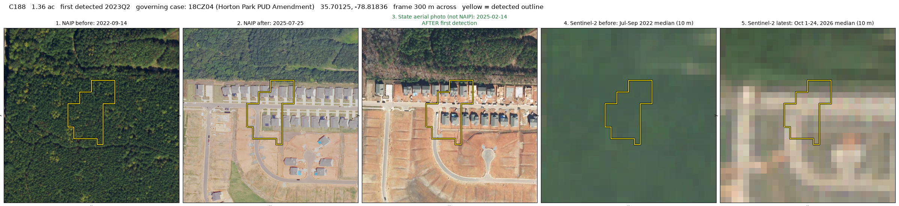

## C189

1.3 acres · first detected 2026 Q1 · governing case: 22CZ22 (Elevate 64)

**Verdict: Cleared**

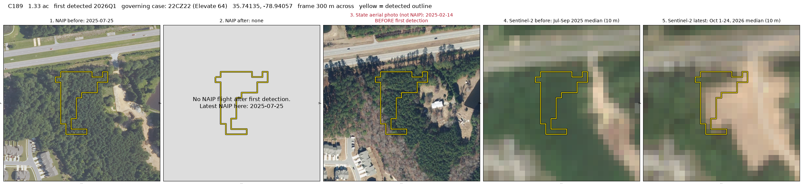

## C190

1.3 acres · first detected 2025 Q1 · governing case: 18CZ02 (Friendship Station PUD Amendment)

**Verdict: Cleared**

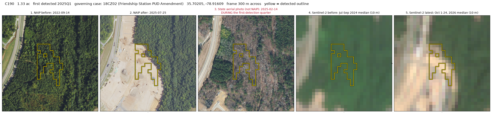

## C191

1.3 acres · first detected 2023 Q2 · governing case: 21CZ16 (MORNINGSTAR LG)

**Verdict: Cleared**

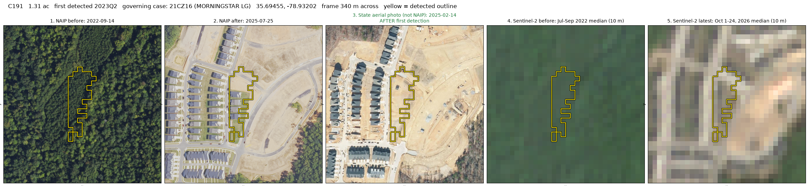

## C192

1.3 acres · first detected 2023 Q3 · governing case: 21CZ16 (MORNINGSTAR LG)

**Verdict: Cleared**

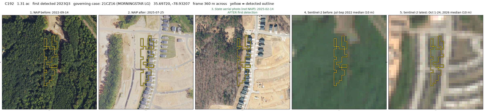

## C193

1.3 acres · first detected 2025 Q1 · governing case: 22CZ07 (CHAPEL RIDGE N)

**Verdict: Cleared**

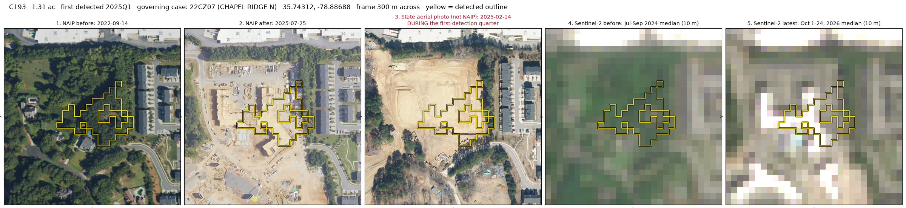

## C194

1.3 acres · first detected 2023 Q3 · governing case: 18CZ04 (Horton Park PUD Amendment)

**Verdict: Cleared**

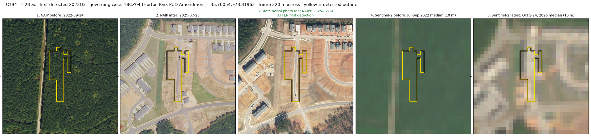

## C195

1.3 acres · first detected 2025 Q3 · governing case: 25CZ18 (Veridea SD Plan Amendment)

**Verdict: Cleared**

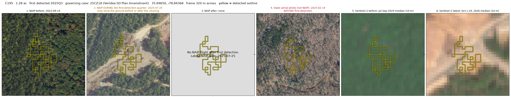

## C196

1.3 acres · first detected 2023 Q2 · governing case: 21CZ16 (MORNINGSTAR LG)

**Verdict: Cleared**

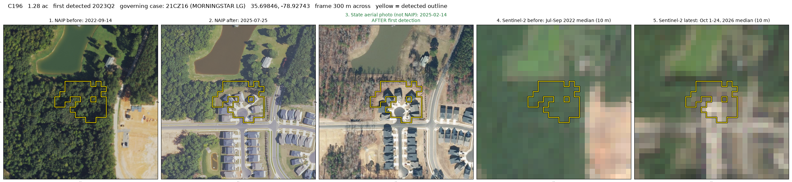

## C197

1.3 acres · first detected 2023 Q2 · governing case: 21CZ16 (MORNINGSTAR LG)

**Verdict: Cleared**

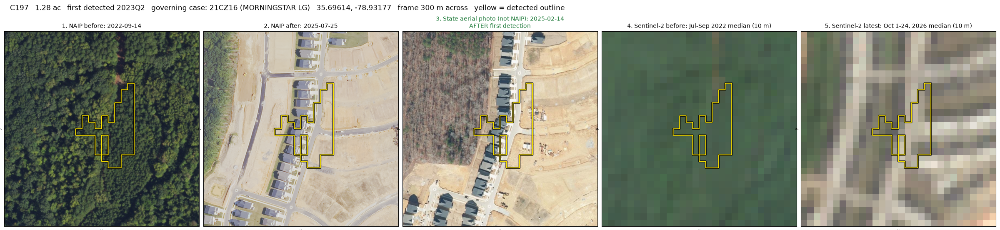

## C198

1.3 acres · first detected 2026 Q1 · governing case: 25CZ18 (Veridea SD Plan Amendment)

**Verdict: Cleared**

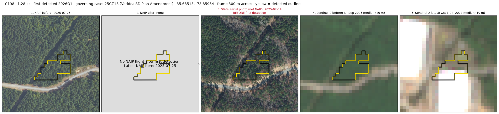

## C199

1.3 acres · first detected 2024 Q3 · governing case: 23CZ09 (HATCHER PROPERTY)

**Verdict: Cleared**

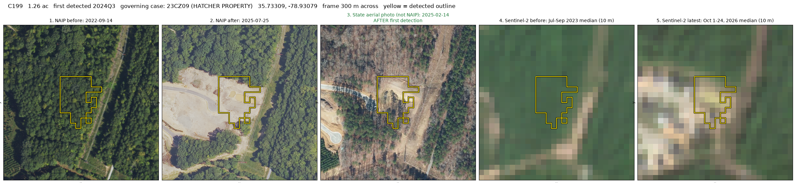

## C200

1.3 acres · first detected 2025 Q4 · governing case: 14CZ29 (APEX OLIVE, LLC)

**Verdict: Cleared**

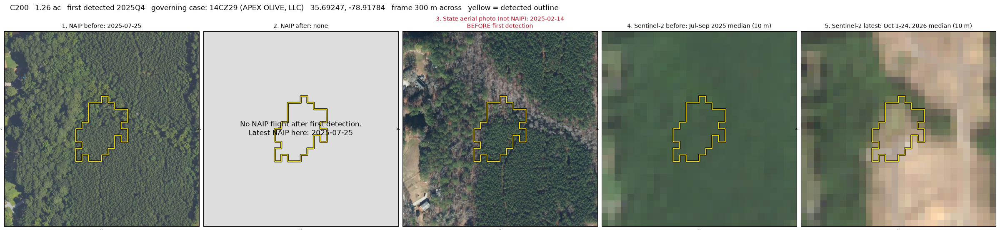

Page 10 of 12: [1](README.md) · [2](page-02.md) · [3](page-03.md) · [4](page-04.md) · [5](page-05.md) · [6](page-06.md) · [7](page-07.md) · [8](page-08.md) · [9](page-09.md) · **10** · [11](page-11.md) · [12](page-12.md)
