# The published count: all 238 clearings

Every clearing in the count of 929 acres published in fall 2026. 238 checks: 207 cleared, 31 partly cleared. Each picture shows the same ground before and after, with the detected outline in yellow. The verdict under it is the reviewer's (Adam Whitaker, the author). Verdicts as a table: [verify_log.csv](../verify_log.csv).

Page 11 of 12: [1](README.md) · [2](page-02.md) · [3](page-03.md) · [4](page-04.md) · [5](page-05.md) · [6](page-06.md) · [7](page-07.md) · [8](page-08.md) · [9](page-09.md) · [10](page-10.md) · **11** · [12](page-12.md)

## C201

1.3 acres · first detected 2025 Q4 · governing case: 22CZ21 (APEX LIGHT INDUS)

**Verdict: Cleared**

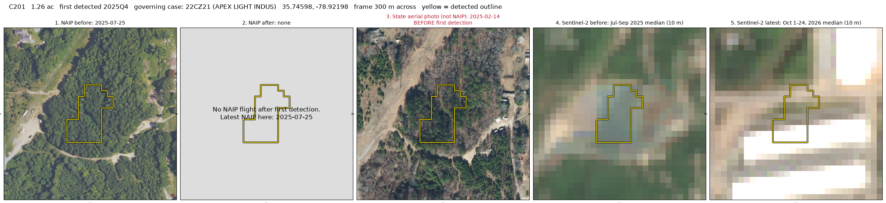

## C202

1.3 acres · first detected 2023 Q4 · governing case: 22CZ24 (APEX GATEWAY PH1)

**Verdict: Cleared**

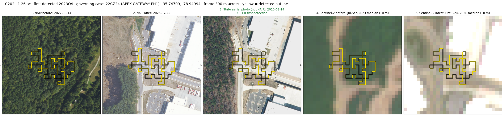

## C203

1.2 acres · first detected 2025 Q2 · governing case: 25CZ18 (Veridea SD Plan Amendment)

**Verdict: Cleared**

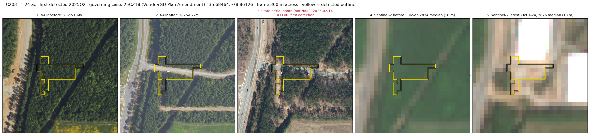

## C204

1.2 acres · first detected 2026 Q2 · governing case: 25CZ18 (Veridea SD Plan Amendment)

**Verdict: Cleared**

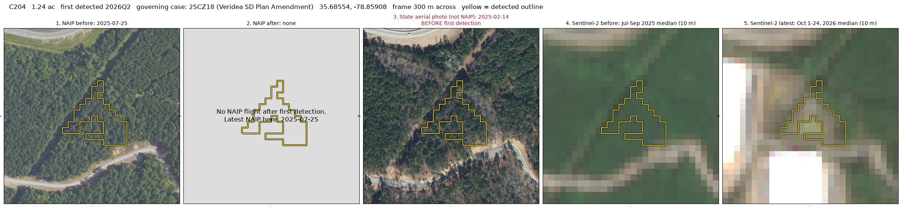

## C205

1.2 acres · first detected 2025 Q2 · governing case: 25CZ18 (Veridea SD Plan Amendment)

**Verdict: Cleared**

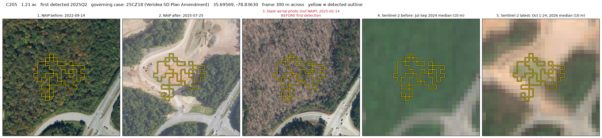

## C206

1.2 acres · first detected 2024 Q2 · governing case: 02CU11 (MDC HOMES)

**Verdict: Cleared**

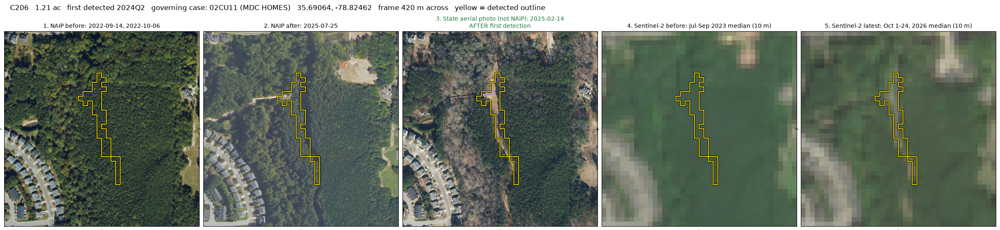

## C207

1.2 acres · first detected 2025 Q4 · governing case: 25CZ18 (Veridea SD Plan Amendment)

**Verdict: Cleared**

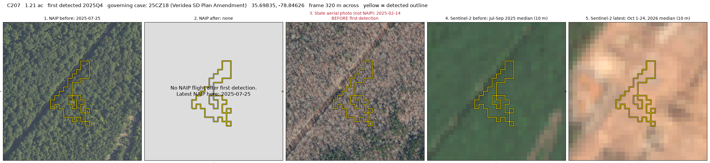

## C208

1.2 acres · first detected 2024 Q2 · governing case: 07ETJ24 (TOWN OF APEX)

**Verdict: Partly cleared** (about 95% of the outline cleared)

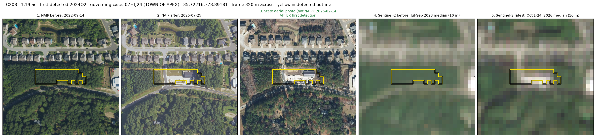

## C209

1.1 acres · first detected 2025 Q1 · governing case: 25CZ18 (Veridea SD Plan Amendment)

**Verdict: Partly cleared** (about 95% of the outline cleared)

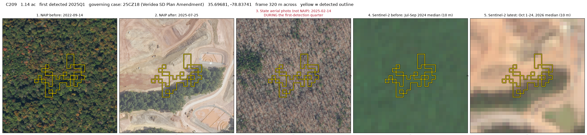

## C210

1.1 acres · first detected 2026 Q3 · governing case: 25CZ18 (Veridea SD Plan Amendment)

**Verdict: Cleared**

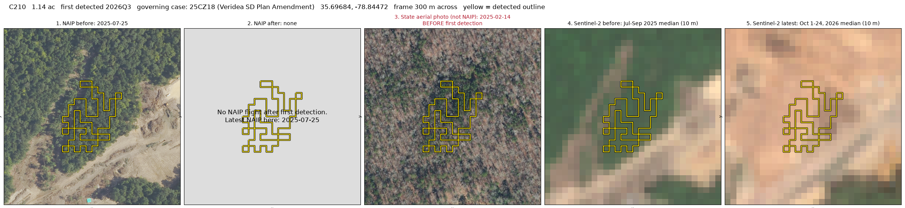

## C211

1.1 acres · first detected 2025 Q2 · governing case: 17CZ20 (ROBERTS CROSSING)

**Verdict: Cleared**

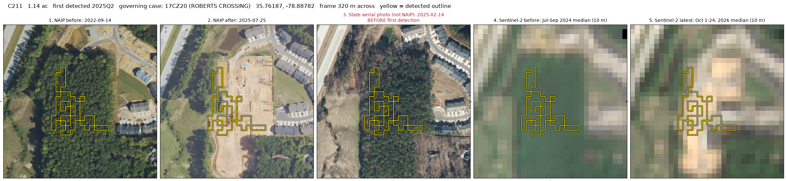

## C212

1.1 acres · first detected 2023 Q1 · governing case: 22CZ14 ([street address])

**Verdict: Cleared**

*Picture held back: the clearing sits mostly on one home lot.*

## C213

1.1 acres · first detected 2026 Q1 · governing case: 25CZ18 (Veridea SD Plan Amendment)

**Verdict: Cleared**

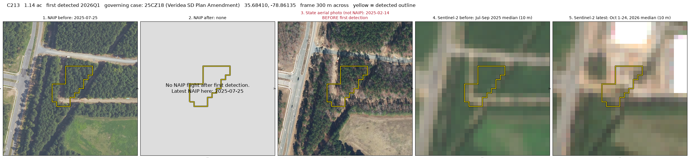

## C214

1.1 acres · first detected 2023 Q2 · governing case: 20CZ15 ([private applicant])

**Verdict: Cleared**

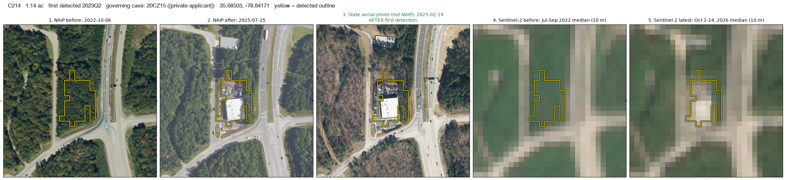

## C215

1.1 acres · first detected 2025 Q4 · governing case: 24CZ12 (OLIVER PROPERTY)

**Verdict: Cleared**

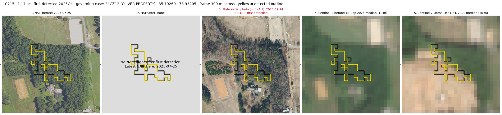

## C216

1.1 acres · first detected 2024 Q3 · governing case: 21CZ13 (EVANS ROAD PUD)

**Verdict: Cleared**

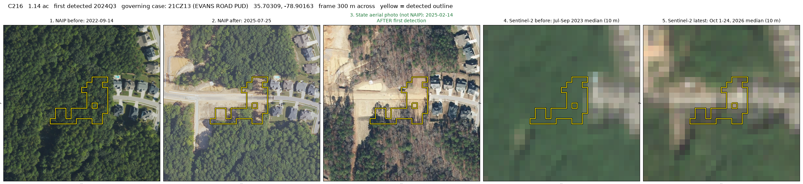

## C217

1.1 acres · first detected 2024 Q2 · governing case: 20CZ04 (KOBRA TRACTS)

**Verdict: Cleared**

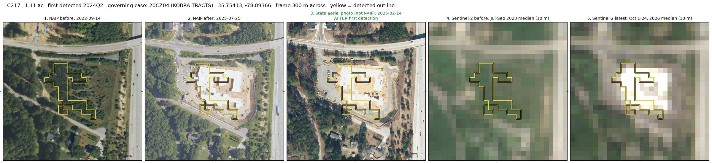

## C218

1.1 acres · first detected 2023 Q1 · governing case: no case

**Verdict: Cleared**

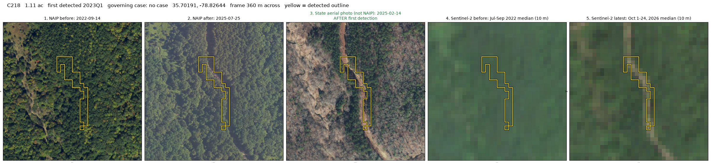

## C219

1.1 acres · first detected 2025 Q3 · governing case: 23CZ09 (HATCHER PROPERTY)

**Verdict: Cleared**

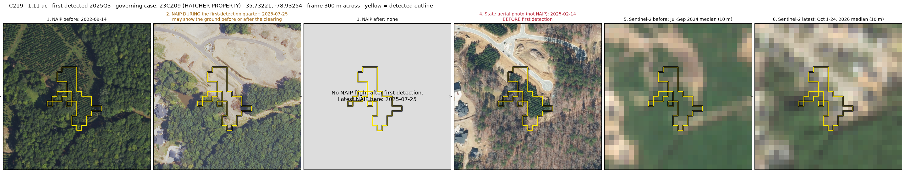

## C220

1.1 acres · first detected 2026 Q3 · governing case: 07ETJ24 (TOWN OF APEX)

**Verdict: Partly cleared** (about 90% of the outline cleared)

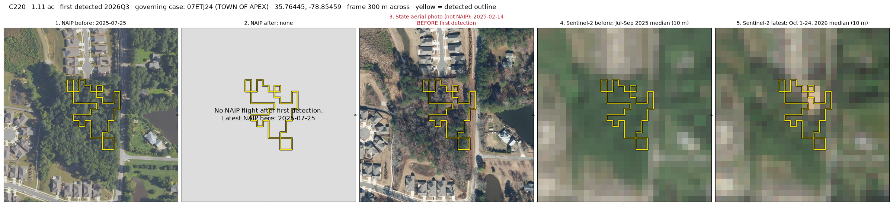

Page 11 of 12: [1](README.md) · [2](page-02.md) · [3](page-03.md) · [4](page-04.md) · [5](page-05.md) · [6](page-06.md) · [7](page-07.md) · [8](page-08.md) · [9](page-09.md) · [10](page-10.md) · **11** · [12](page-12.md)
