# The 2017 to 2026 series: 100 clearings drawn at random

A stratified random sample of the 497 clearings in the longer series. 100 checks: 83 cleared, 14 partly cleared, 2 could not tell, 1 not cleared. Each picture shows the same ground before and after, with the detected outline in yellow. The verdict under it is the reviewer's (Adam Whitaker, the author). Verdicts as a table: [verify_log.csv](../verify_log.csv).

Page 1 of 5: **1** · [2](page-02.md) · [3](page-03.md) · [4](page-04.md) · [5](page-05.md)

## D0106

5.5 acres · first detected 2017 Q4 · governing case: 16CZ01 (PULTE GROUP)

**Verdict: Cleared**

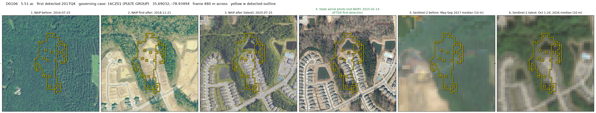

## D0067

7.8 acres · first detected 2017 Q4 · governing case: 13CZ30 ([private applicant])

**Verdict: Cleared**

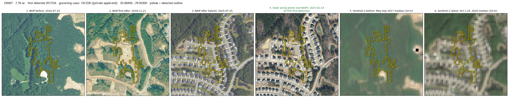

## D0023

16.9 acres · first detected 2017 Q4 · governing case: 14CZ25 (JONES & CNOSSEN)

**Verdict: Cleared**

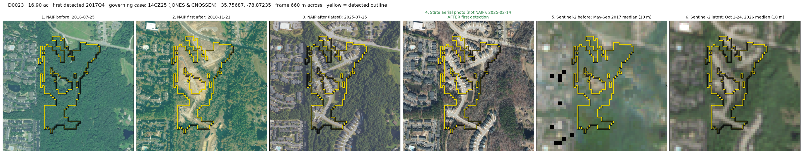

## D0268

2.1 acres · first detected 2017 Q4 · governing case: 13CZ18 (PULTE HOME CORP)

**Verdict: Cleared**

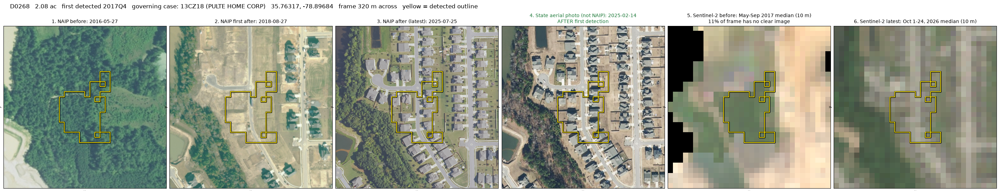

## D0460

1.1 acres · first detected 2017 Q4 · governing case: 16CZ30 (LSTAR MNGMNT)

**Verdict: Cleared**

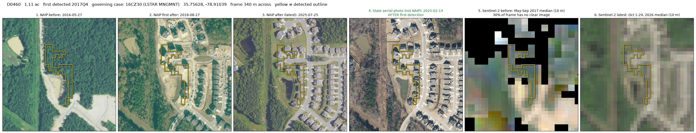

## D0262

2.1 acres · first detected 2017 Q4 · governing case: no case

**Verdict: Cleared**

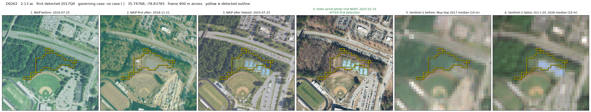

## D0061

8.7 acres · first detected 2018 Q4 · governing case: 18CZ02 (FRIENDSHIP STAT)

**Verdict: Cleared**

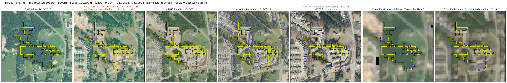

## D0128

4.7 acres · first detected 2018 Q2 · governing case: 17CZ06 (PULTE HOME CO)

**Verdict: Cleared**

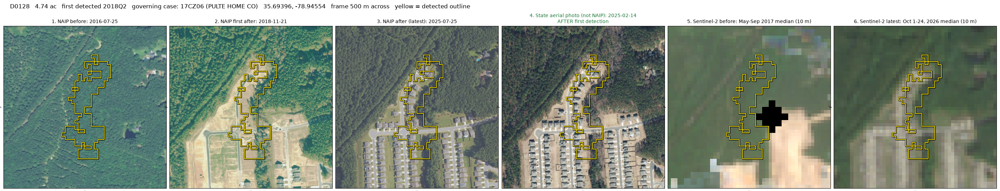

## D0006

38.1 acres · first detected 2018 Q2 · governing case: 18CZ31 (WESTFORD PUD)

**Verdict: Cleared**

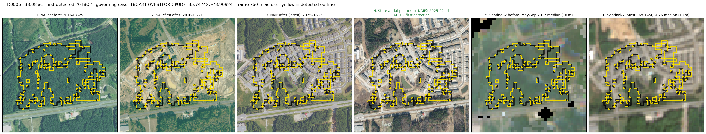

## D0264

2.1 acres · first detected 2018 Q2 · governing case: 15CZ02 ([private applicant])

**Verdict: Cleared**

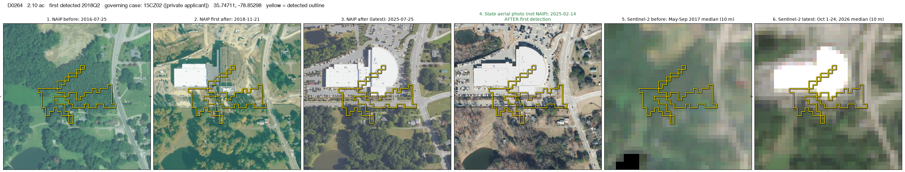

## D0466

1.1 acres · first detected 2018 Q1 · governing case: 13CZ30 ([private applicant])

**Verdict: Cleared**

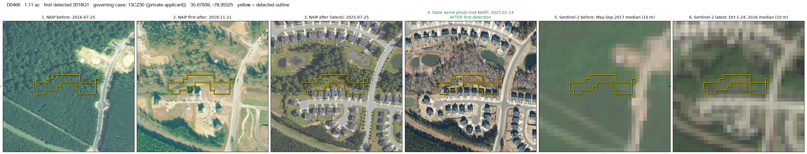

## D0233

2.4 acres · first detected 2018 Q3 · governing case: 15CZ26 (BAKER RESDNTL)

**Verdict: Cleared**

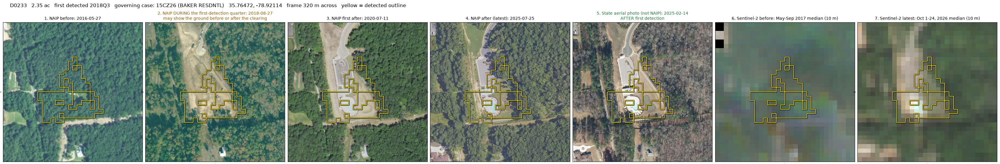

## D0371

1.5 acres · first detected 2018 Q2 · governing case: 16CZ15 ([private applicant])

**Verdict: Cleared**

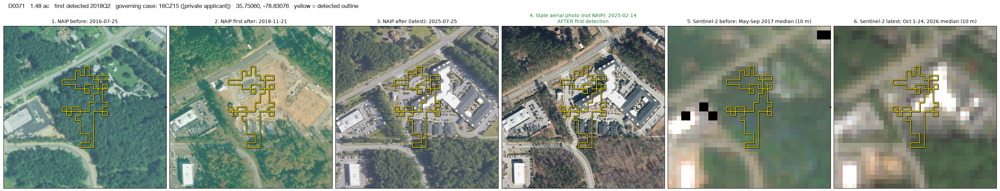

## D0318

1.8 acres · first detected 2018 Q2 · governing case: 15CZ01 ([private applicant])

**Verdict: Not cleared**

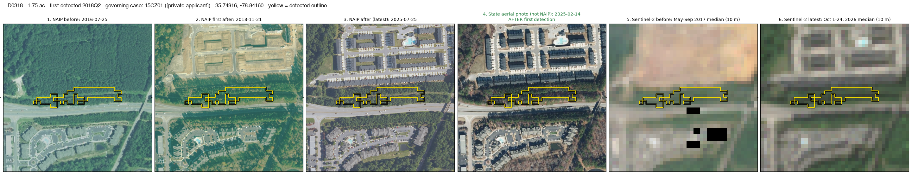

## D0303

1.8 acres · first detected 2018 Q1 · governing case: 14CZ14 (MERITAGE HOMES)

**Verdict: Cleared**

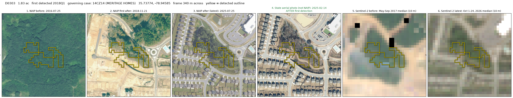

## D0380

1.4 acres · first detected 2018 Q4 · governing case: 22CZ21 (APEX LIGHT INDUS)

**Verdict: Cleared**

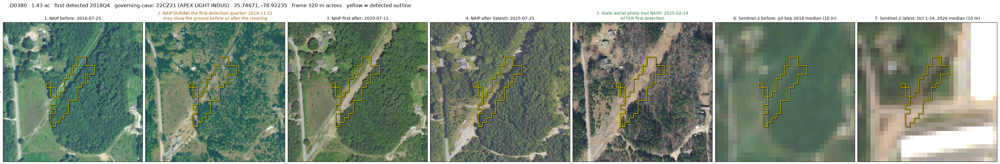

## D0063

8.6 acres · first detected 2019 Q4 · governing case: 20CZ05 (MCADAMS COMPANY)

**Verdict: Cleared**

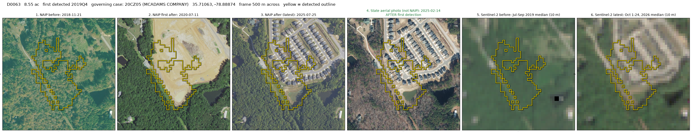

## D0168

3.5 acres · first detected 2019 Q4 · governing case: 09CZ03 (TOWN OF APEX)

**Verdict: Cleared**

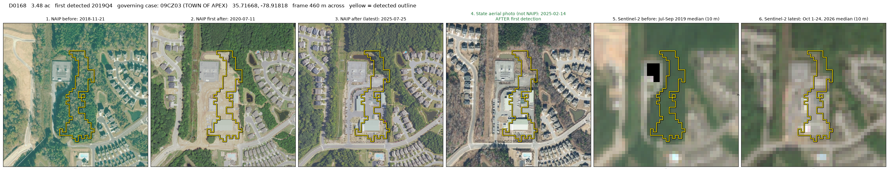

## D0444

1.2 acres · first detected 2019 Q4 · governing case: 15CZ33 (MCADAMS COMPANY)

**Verdict: Cleared**

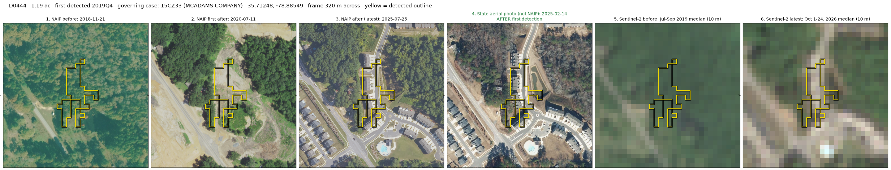

## D0378

1.5 acres · first detected 2019 Q2 · governing case: 07ETJ24 (TOWN OF APEX)

**Verdict: Partly cleared** (about 50% of the outline cleared)

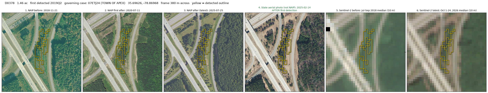

Page 1 of 5: **1** · [2](page-02.md) · [3](page-03.md) · [4](page-04.md) · [5](page-05.md)
