# The 2017 to 2026 series: 100 clearings drawn at random

A stratified random sample of the 497 clearings in the longer series. 100 checks: 83 cleared, 14 partly cleared, 2 could not tell, 1 not cleared. Each picture shows the same ground before and after, with the detected outline in yellow. The verdict under it is the reviewer's (Adam Whitaker, the author). Verdicts as a table: [verify_log.csv](../verify_log.csv).

Page 2 of 5: [1](README.md) · **2** · [3](page-03.md) · [4](page-04.md) · [5](page-05.md)

## D0467

1.1 acres · first detected 2019 Q3 · governing case: 22CZ24 (APEX GATEWAY PH1)

**Verdict: Cleared**

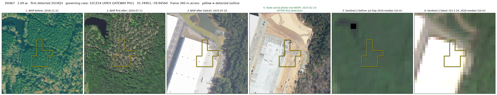

## D0355

1.6 acres · first detected 2019 Q1 · governing case: 15CZ32 ([private applicant])

**Verdict: Cleared**

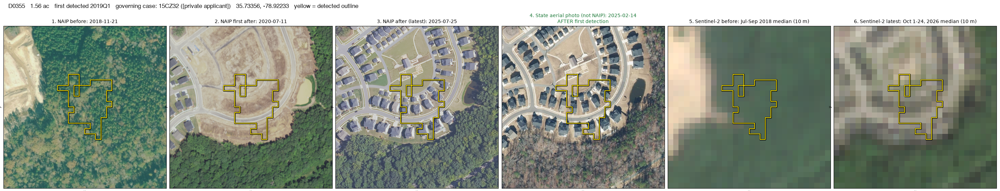

## D0138

4.4 acres · first detected 2020 Q2 · governing case: 21CZ28 (RETREAT AT CEDAR)

**Verdict: Cleared**

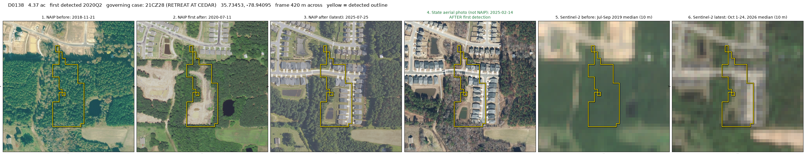

## D0095

6.1 acres · first detected 2020 Q1 · governing case: 18CZ17 (PEAK ENGINEERING)

**Verdict: Cleared**

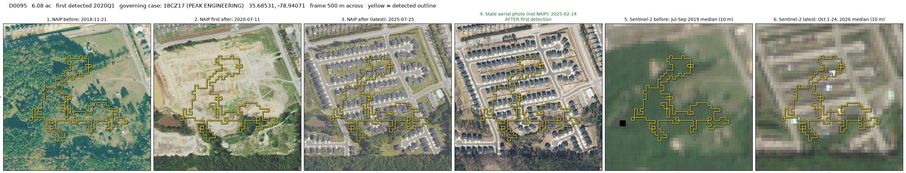

## D0170

3.5 acres · first detected 2020 Q1 · governing case: 18CZ17 (PEAK ENGINEERING)

**Verdict: Partly cleared** (about 95% of the outline cleared)

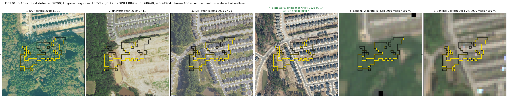

## D0001

63.8 acres · first detected 2020 Q2 · governing case: 23CZ05 (PLEASANT PARK)

**Verdict: Cleared**

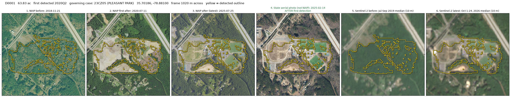

## D0228

2.4 acres · first detected 2020 Q3 · governing case: 18CZ29 (EPCON COMMNTIES)

**Verdict: Cleared**

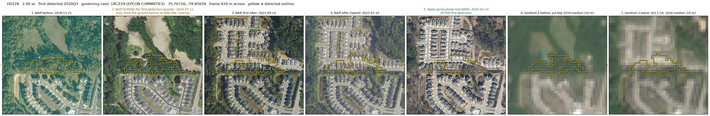

## D0266

2.1 acres · first detected 2020 Q1 · governing case: 15CZ20 (WITHERS & RAVENE)

**Verdict: Cleared**

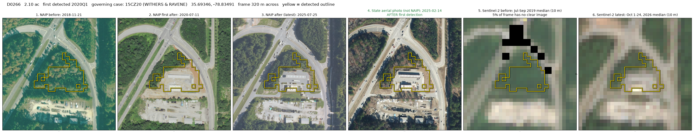

## D0495

1.0 acres · first detected 2020 Q2 · governing case: 20CZ05 (MCADAMS COMPANY)

**Verdict: Cleared**

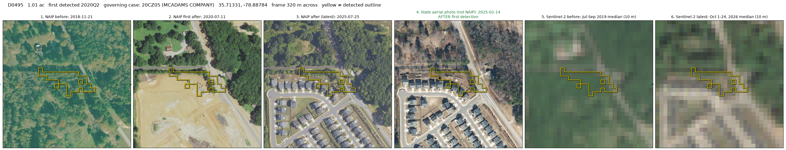

## D0205

2.7 acres · first detected 2020 Q3 · governing case: 21CZ03 (TOLL BROTHERS)

**Verdict: Partly cleared** (about 80% of the outline cleared)

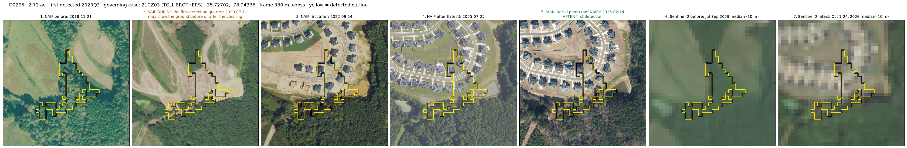

## D0387

1.4 acres · first detected 2020 Q2 · governing case: 15CZ33 (MCADAMS COMPANY)

**Verdict: Cleared**

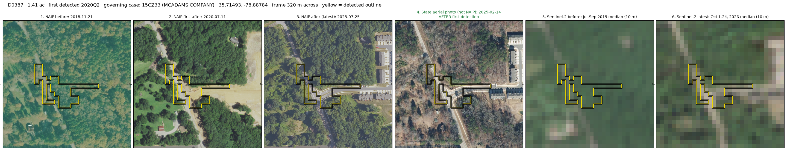

## D0140

4.3 acres · first detected 2021 Q2 · governing case: 19CZ05 (JAINIX GREEN)

**Verdict: Cleared**

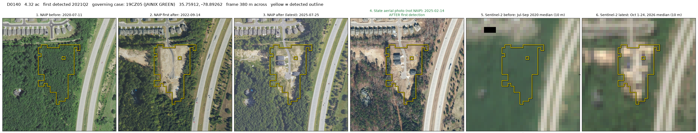

## D0161

3.7 acres · first detected 2021 Q2 · governing case: 19CZ24 (UPCHRCH-WLLMS HS)

**Verdict: Cleared**

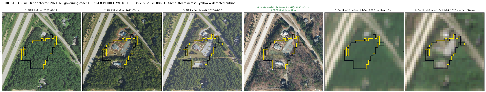

## D0039

11.5 acres · first detected 2021 Q2 · governing case: 07ETJ24 (TOWN OF APEX)

**Verdict: Cleared**

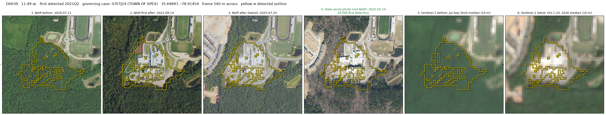

## D0339

1.7 acres · first detected 2021 Q1 · governing case: 18CZ05 (MILESTONE DEV)

**Verdict: Cleared**

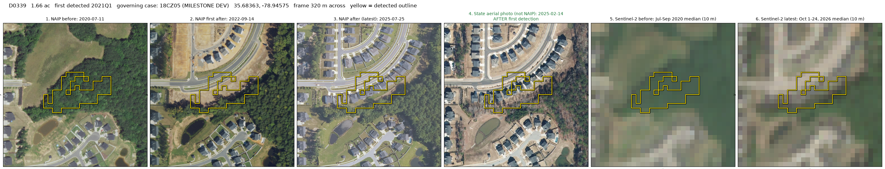

## D0359

1.6 acres · first detected 2021 Q1 · governing case: 18CZ34 (WEEKLEY HOMES)

**Verdict: Cleared**

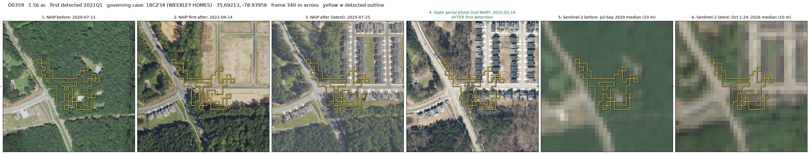

## D0283

1.9 acres · first detected 2021 Q3 · governing case: 18CZ35 (ST INVESTMENTS)

**Verdict: Partly cleared** (about 90% of the outline cleared)

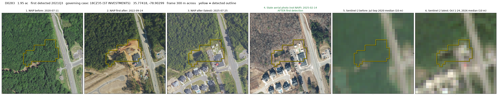

## D0276

2.0 acres · first detected 2021 Q1 · governing case: 18CZ05 (MILESTONE DEV)

**Verdict: Cleared**

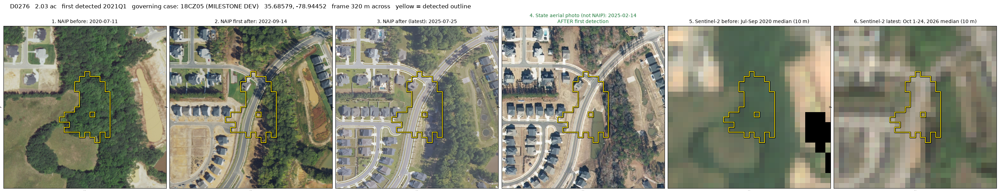

## D0411

1.3 acres · first detected 2021 Q3 · governing case: 01TRZ08 (TOWN OF APEX)

**Verdict: Cleared**

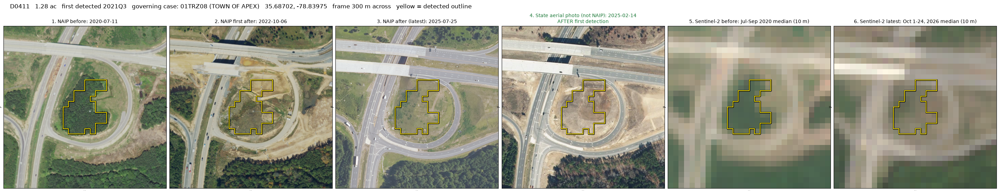

## D0231

2.4 acres · first detected 2021 Q4 · governing case: 24CZ18 (EXPERIENCEONE)

**Verdict: Cleared**

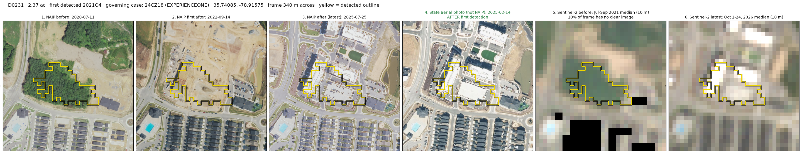

Page 2 of 5: [1](README.md) · **2** · [3](page-03.md) · [4](page-04.md) · [5](page-05.md)
