# The 2017 to 2026 series: 100 clearings drawn at random

A stratified random sample of the 497 clearings in the longer series. 100 checks: 83 cleared, 14 partly cleared, 2 could not tell, 1 not cleared. Each picture shows the same ground before and after, with the detected outline in yellow. The verdict under it is the reviewer's (Adam Whitaker, the author). Verdicts as a table: [verify_log.csv](../verify_log.csv).

Page 3 of 5: [1](README.md) · [2](page-02.md) · **3** · [4](page-04.md) · [5](page-05.md)

## D0156

3.8 acres · first detected 2022 Q1 · governing case: 23CZ01 (CASH CORPORATE)

**Verdict: Cleared**

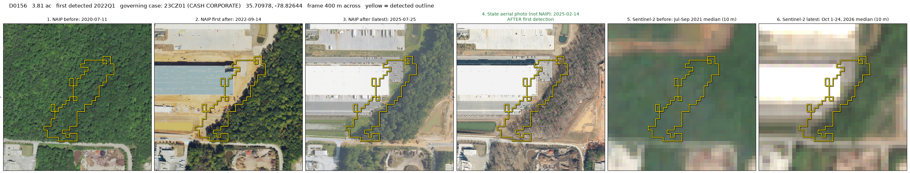

## D0068

7.7 acres · first detected 2022 Q2 · governing case: 23CZ01 (CASH CORPORATE)

**Verdict: Cleared**

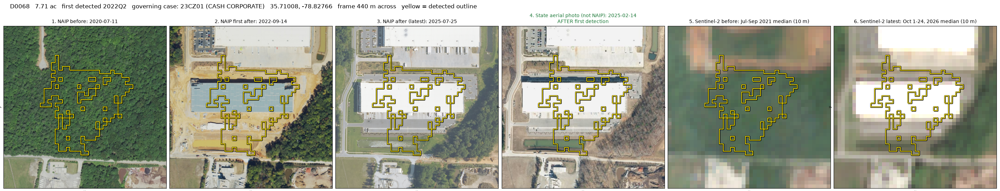

## D0007

35.6 acres · first detected 2022 Q2 · governing case: 20CZ01 (LENNAR)

**Verdict: Cleared**

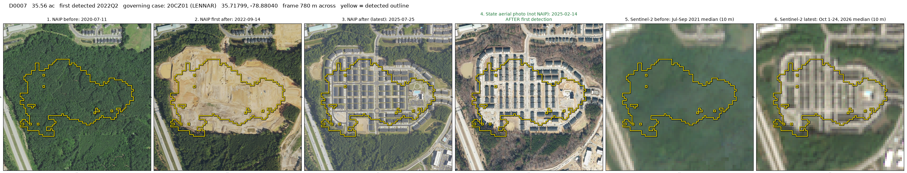

## D0302

1.8 acres · first detected 2022 Q2 · governing case: 07ETJ24 (TOWN OF APEX)

**Verdict: Cleared**

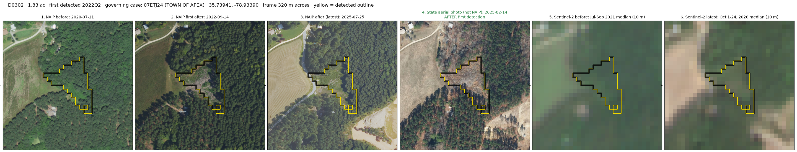

## D0385

1.4 acres · first detected 2022 Q4 · governing case: 18CZ02 (FRIENDSHIP STAT)

**Verdict: Cleared**

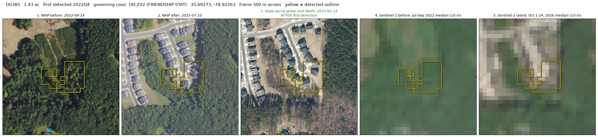

## D0217

2.5 acres · first detected 2022 Q1 · governing case: 23CZ01 (CASH CORPORATE)

**Verdict: Cleared**

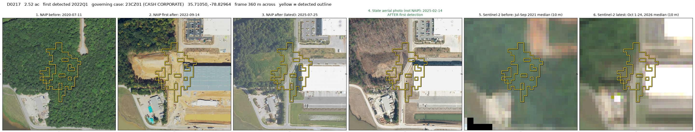

## D0190

3.0 acres · first detected 2022 Q1 · governing case: 14CZ14 (MERITAGE HOMES)

**Verdict: Cleared**

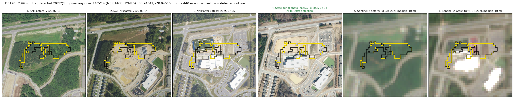

## D0310

1.8 acres · first detected 2022 Q1 · governing case: 20CZ01 (LENNAR)

**Verdict: Partly cleared** (about 90% of the outline cleared)

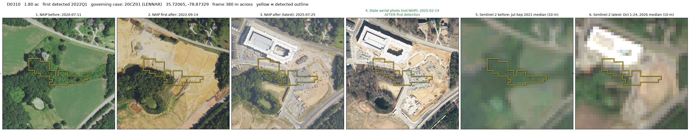

## D0148

4.0 acres · first detected 2023 Q1 · governing case: 20CZ12 (FELTON GROVE HS)

**Verdict: Cleared**

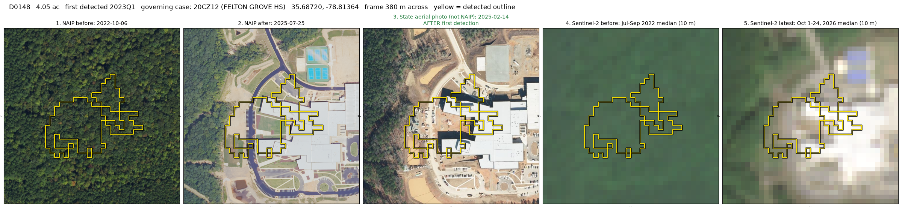

## D0182

3.1 acres · first detected 2023 Q3 · governing case: 21CZ16 (MORNINGSTAR LG)

**Verdict: Cleared**

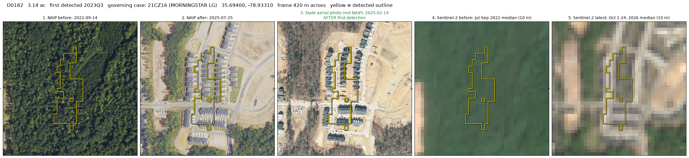

## D0153

3.9 acres · first detected 2023 Q3 · governing case: 22CZ24 (APEX GATEWAY PH1)

**Verdict: Cleared**

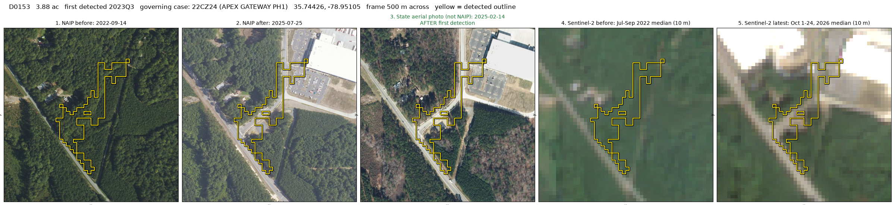

## D0134

4.5 acres · first detected 2023 Q4 · governing case: 22CZ24 (APEX GATEWAY PH1)

**Verdict: Cleared**

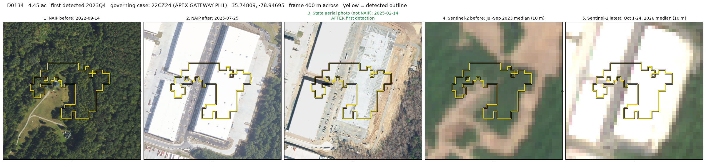

## D0002

52.3 acres · first detected 2023 Q2 · governing case: 20CZ12 (FELTON GROVE HS)

**Verdict: Cleared**

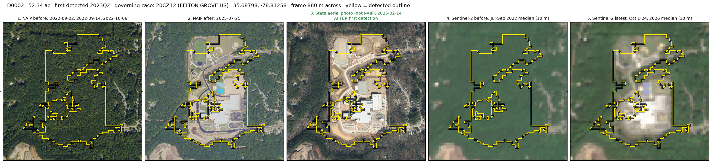

## D0278

2.0 acres · first detected 2023 Q3 · governing case: 21CZ04 (WILLIAMS FARM PD)

**Verdict: Partly cleared** (about 90% of the outline cleared)

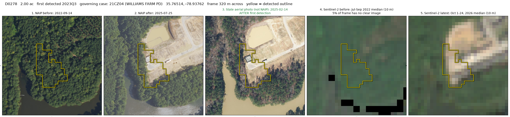

## D0481

1.1 acres · first detected 2023 Q3 · governing case: 22CZ24 (APEX GATEWAY PH1)

**Verdict: Cleared**

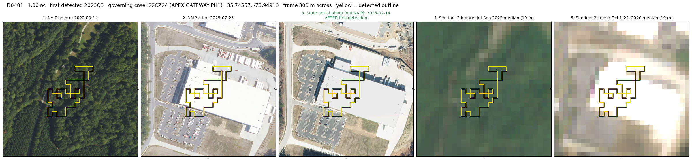

## D0206

2.7 acres · first detected 2023 Q1 · governing case: 18CZ04 (MFW INVESTMENTS)

**Verdict: Cleared**

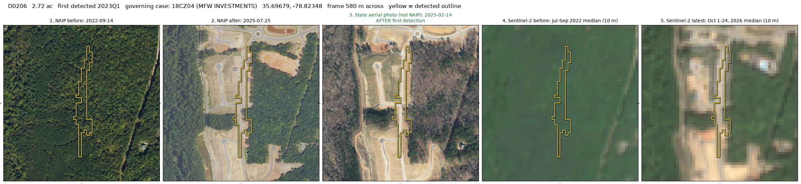

## D0398

1.4 acres · first detected 2023 Q2 · governing case: 20CZ15 ([private applicant])

**Verdict: Cleared**

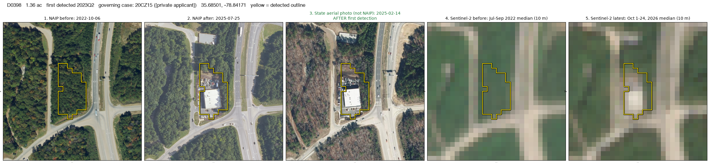

## D0204

2.7 acres · first detected 2023 Q3 · governing case: 01TRZ08 (TOWN OF APEX)

**Verdict: Cleared**

*Picture held back: the clearing sits mostly on one home lot.*

## D0245

2.3 acres · first detected 2023 Q2 · governing case: 21CZ16 (MORNINGSTAR LG)

**Verdict: Cleared**

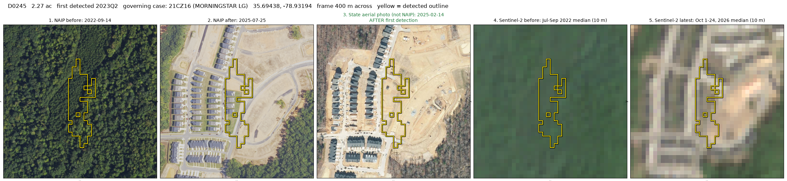

## D0429

1.2 acres · first detected 2023 Q3 · governing case: 22CZ24 (APEX GATEWAY PH1)

**Verdict: Cleared**

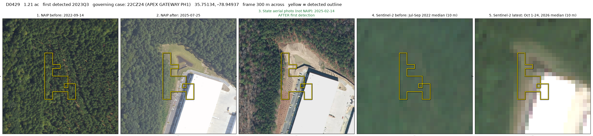

Page 3 of 5: [1](README.md) · [2](page-02.md) · **3** · [4](page-04.md) · [5](page-05.md)
