# The 2017 to 2026 series: 100 clearings drawn at random

A stratified random sample of the 497 clearings in the longer series. 100 checks: 83 cleared, 14 partly cleared, 2 could not tell, 1 not cleared. Each picture shows the same ground before and after, with the detected outline in yellow. The verdict under it is the reviewer's (Adam Whitaker, the author). Verdicts as a table: [verify_log.csv](../verify_log.csv).

Page 4 of 5: [1](README.md) · [2](page-02.md) · [3](page-03.md) · **4** · [5](page-05.md)

## D0485

1.0 acres · first detected 2023 Q2 · governing case: 21CZ04 (WILLIAMS FARM PD)

**Verdict: Cleared**

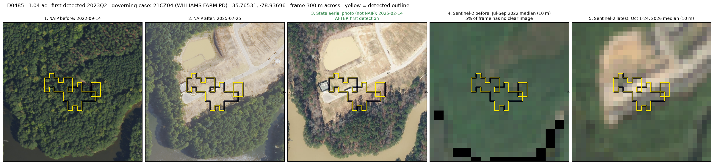

## D0177

3.3 acres · first detected 2024 Q1 · governing case: 18CZ04 (MFW INVESTMENTS)

**Verdict: Cleared**

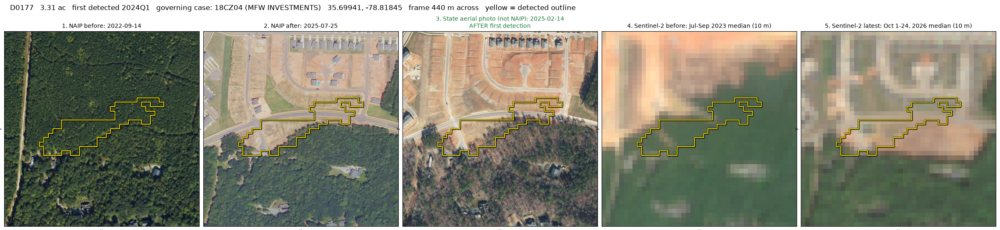

## D0099

6.0 acres · first detected 2024 Q4 · governing case: 22CZ13 ([street address])

**Verdict: Cleared**

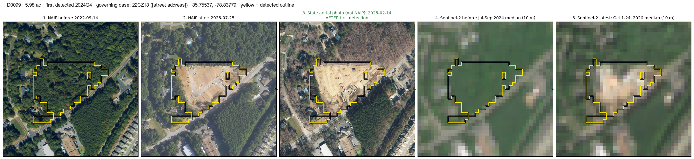

## D0145

4.2 acres · first detected 2024 Q4 · governing case: 22CZ23 (YELLOWBRIDGE PUD)

**Verdict: Cleared**

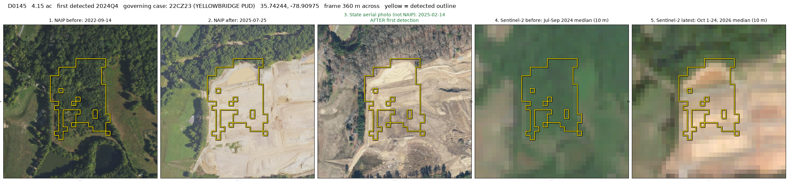

## D0044

10.6 acres · first detected 2024 Q2 · governing case: 21CZ13 (EVANS ROAD PUD)

**Verdict: Cleared**

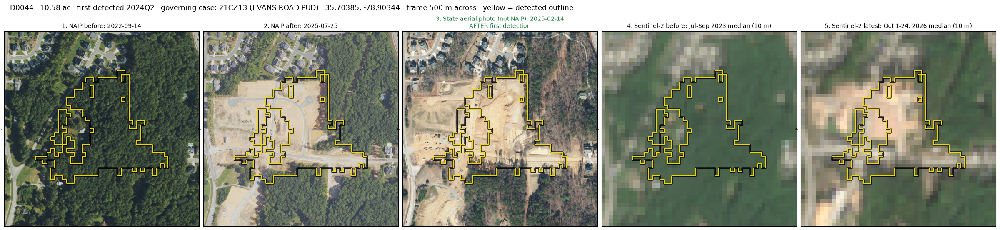

## D0441

1.2 acres · first detected 2024 Q1 · governing case: 21CZ06 (JENKS RD VET HOS)

**Verdict: Cleared**

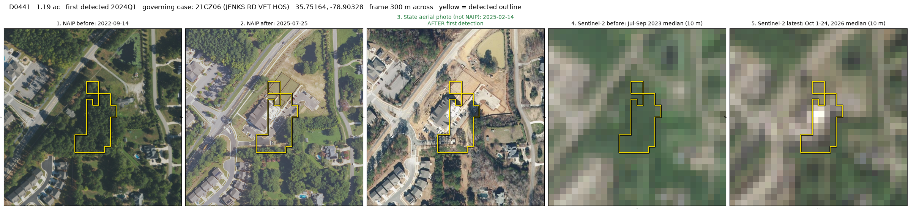

## D0253

2.2 acres · first detected 2024 Q4 · governing case: 22CZ23 (YELLOWBRIDGE PUD)

**Verdict: Partly cleared** (about 90% of the outline cleared)

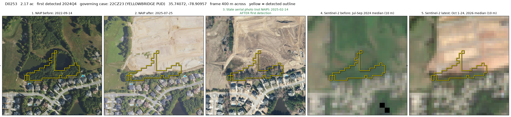

## D0338

1.7 acres · first detected 2024 Q2 · governing case: 07ETJ24 (TOWN OF APEX)

**Verdict: Cleared**

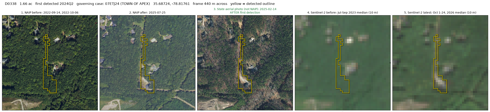

## D0373

1.5 acres · first detected 2024 Q1 · governing case: 18CZ04 (MFW INVESTMENTS)

**Verdict: Partly cleared** (about 90% of the outline cleared)

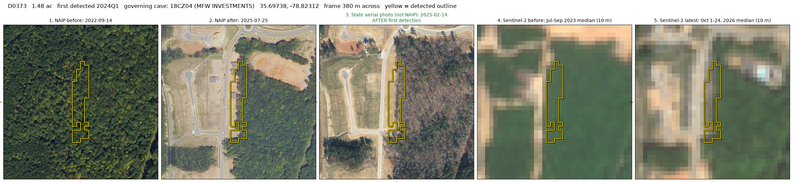

## D0230

2.4 acres · first detected 2024 Q2 · governing case: 21CZ13 (EVANS ROAD PUD)

**Verdict: Cleared**

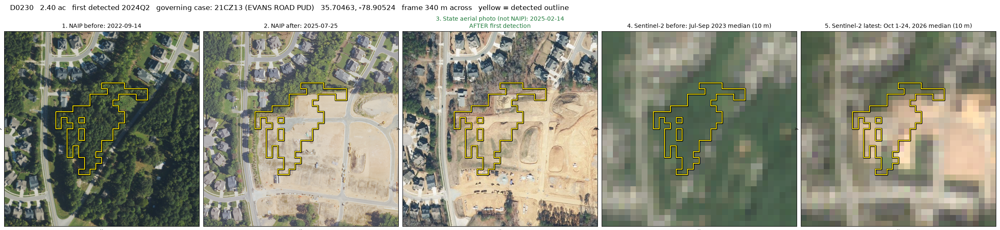

## D0184

3.1 acres · first detected 2025 Q2 · governing case: 24CZ23 (GREENWAY WASTE)

**Verdict: Partly cleared** (about 75% of the outline cleared)

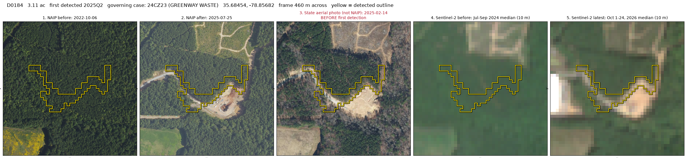

## D0187

3.0 acres · first detected 2025 Q2 · governing case: 14CZ16 (AQUILINE APEX)

**Verdict: Cleared**

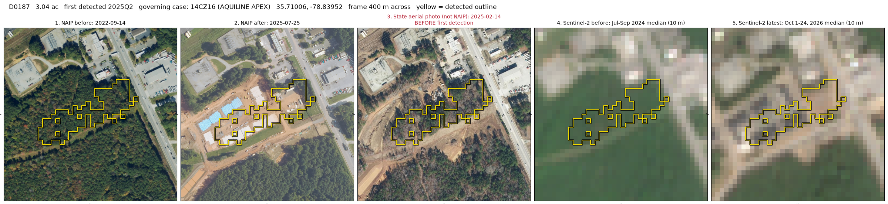

## D0172

3.4 acres · first detected 2025 Q3 · governing case: 24CZ09 (CASTLEBERRY RESE)

**Verdict: Cleared**. Reviewer's note: Cleared - marked based on #6. No sharp photo after the detection date. Judged from the October 2026 satellite image.

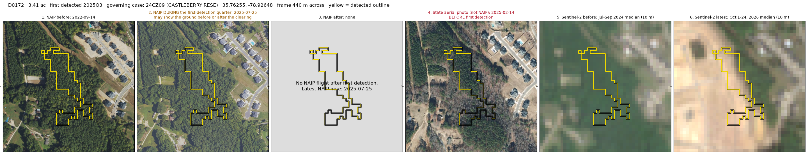

## D0069

7.7 acres · first detected 2025 Q3 · governing case: 25CZ18 (VERIDEA SD PLAN)

**Verdict: Cleared**. Reviewer's note: Cleared - marked based on #6. No sharp photo after the detection date. Judged from the October 2026 satellite image.

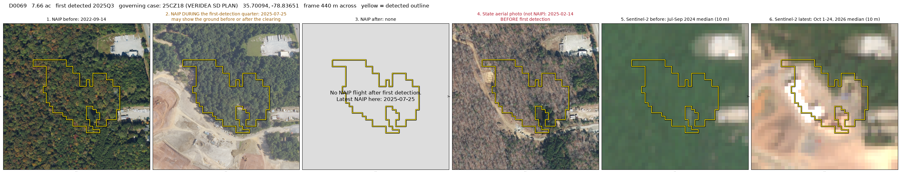

## D0038

11.6 acres · first detected 2025 Q1 · governing case: 21CZ12 (LEGACY PUD)

**Verdict: Cleared**

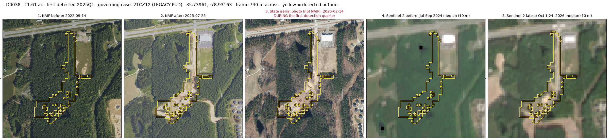

## D0037

12.1 acres · first detected 2025 Q2 · governing case: 21CZ14 (HOLLAND RD PUD)

**Verdict: Cleared**

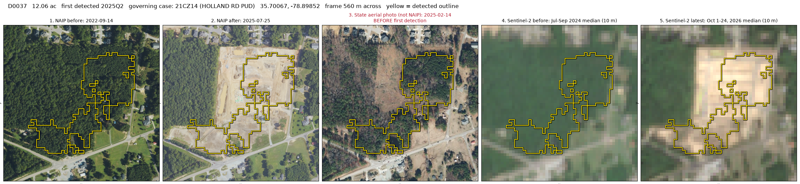

## D0033

12.9 acres · first detected 2025 Q2 · governing case: 17CZ18 (GRACEWOOD PUD)

**Verdict: Cleared**

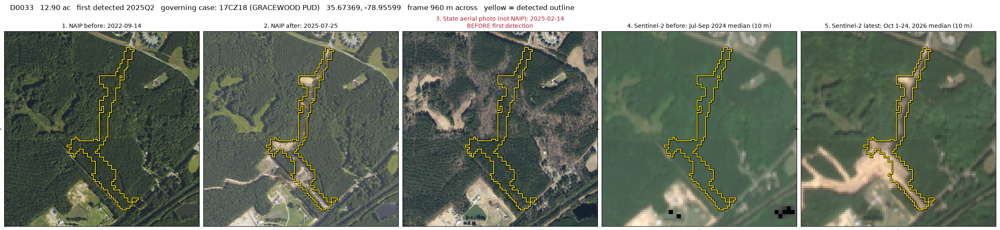

## D0285

1.9 acres · first detected 2025 Q2 · governing case: 21CZ16 (MORNINGSTAR LG)

**Verdict: Cleared**

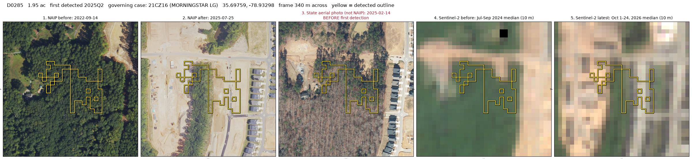

## D0225

2.4 acres · first detected 2025 Q4 · governing case: 25CZ18 (VERIDEA SD PLAN)

**Verdict: Cleared**. Reviewer's note: Cleared - marked based on #5. No sharp photo after the detection date. Judged from the October 2026 satellite image.

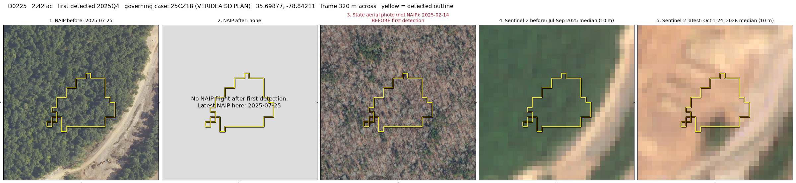

## D0333

1.7 acres · first detected 2025 Q4 · governing case: 23CZ15 (APEX GATEWAY PH2)

**Verdict: Partly cleared** (about 95% of the outline cleared). Reviewer's note: Mostly cleared; possibly fully cleared - marked based on #5. Appears uncleared until the Sentinel - 2 October 1-24, 2026 run where it appears maybe a few trees stayed within the south border.

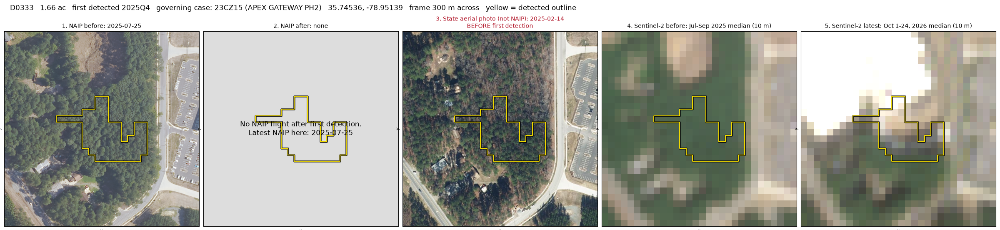

Page 4 of 5: [1](README.md) · [2](page-02.md) · [3](page-03.md) · **4** · [5](page-05.md)
