# The 2017 to 2026 series: 100 clearings drawn at random

A stratified random sample of the 497 clearings in the longer series. 100 checks: 83 cleared, 14 partly cleared, 2 could not tell, 1 not cleared. Each picture shows the same ground before and after, with the detected outline in yellow. The verdict under it is the reviewer's (Adam Whitaker, the author). Verdicts as a table: [verify_log.csv](../verify_log.csv).

Page 5 of 5: [1](README.md) · [2](page-02.md) · [3](page-03.md) · [4](page-04.md) · **5**

## D0368

1.5 acres · first detected 2025 Q2 · governing case: 25CZ18 (VERIDEA SD PLAN)

**Verdict: Cleared**

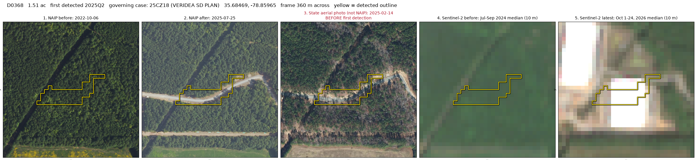

## D0267

2.1 acres · first detected 2025 Q2 · governing case: 17CZ18 (GRACEWOOD PUD)

**Verdict: Partly cleared** (about 80% of the outline cleared). Reviewer's note: Mostly cleared, about 80% - marked based on #5, which shows a sliver of trees. The July 2025 NAIP (#2) already shows a cleared pad and strip.

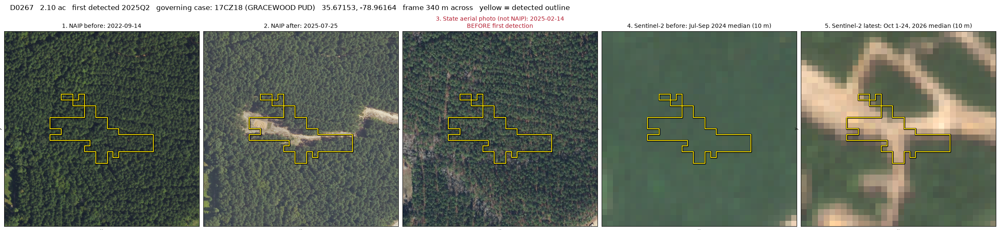

## D0404

1.3 acres · first detected 2025 Q3 · governing case: 17CZ18 (GRACEWOOD PUD)

**Verdict: Cleared**. Reviewer's note: Cleared - marked based on #6. No sharp photo after the detection date. Judged from the October 2026 satellite image.

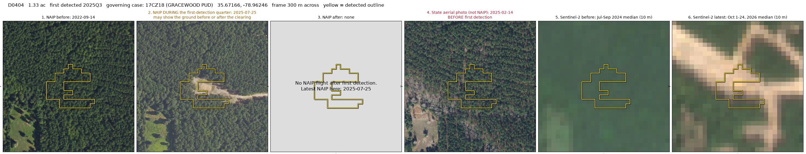

## D0381

1.4 acres · first detected 2025 Q3 · governing case: 13CZ06 (JONES & CNOSSEN)

**Verdict: Could not tell**. Reviewer's note: Hard to tell. #6 you can see some brown - mostly brown. But very pixelated. My guess is fully cleared but marking as can't tell.

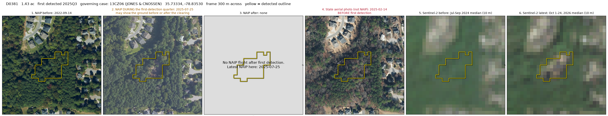

## D0274

2.0 acres · first detected 2025 Q3 · governing case: 14CZ30 ([private applicant])

**Verdict: Partly cleared** (about 95% of the outline cleared). Reviewer's note: Looks fully cleared but giving a little tree credit based on #6

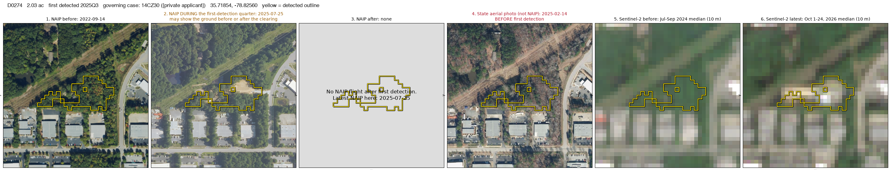

## D0057

9.2 acres · first detected 2026 Q1 · governing case: 25CZ18 (VERIDEA SD PLAN)

**Verdict: Cleared**. Reviewer's note: Cleared - marked based on #5. No sharp photo after the detection date. Judged from the October 2026 satellite image.

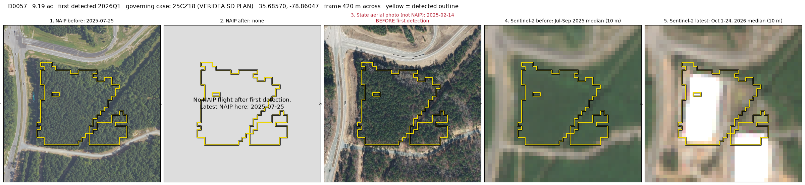

## D0094

6.1 acres · first detected 2026 Q1 · governing case: 14CZ29 (APEX OLIVE, LLC)

**Verdict: Cleared**. Reviewer's note: Cleared - marked based on #5. No sharp photo after the detection date. Judged from the October 2026 satellite image.

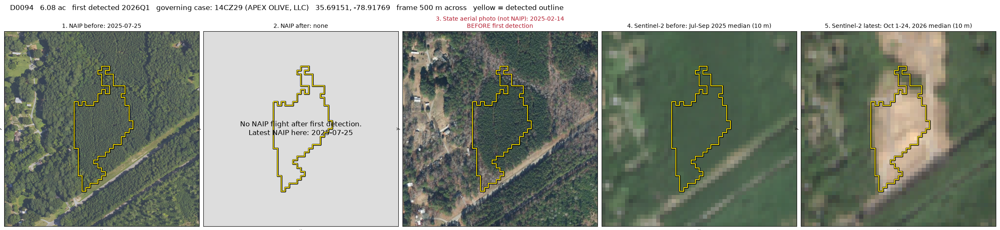

## D0076

7.2 acres · first detected 2026 Q4 · governing case: 17CZ18 (GRACEWOOD PUD)

**Verdict: Cleared**. Reviewer's note: Cleared - marked based on #5. No sharp photo after the detection date. Judged from the October 2026 satellite image.

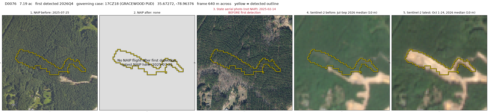

## D0059

8.8 acres · first detected 2026 Q1 · governing case: 14CZ29 (APEX OLIVE, LLC)

**Verdict: Cleared**. Reviewer's note: Cleared - marked based on #5. No sharp photo after the detection date. Judged from the October 2026 satellite image.

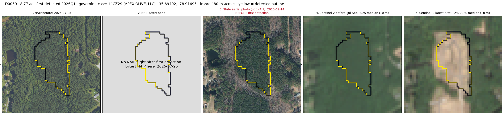

## D0019

19.3 acres · first detected 2026 Q3 · governing case: 25CZ18 (VERIDEA SD PLAN)

**Verdict: Cleared**. Reviewer's note: Cleared - marked based on #5. No sharp photo after the detection date. Judged from the October 2026 satellite image.

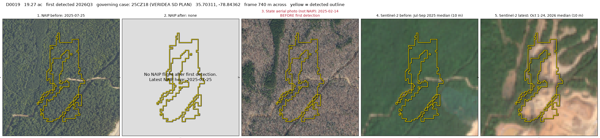

## D0011

25.1 acres · first detected 2026 Q3 · governing case: 25CZ18 (VERIDEA SD PLAN)

**Verdict: Cleared**

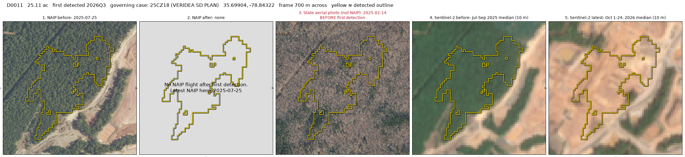

## D0344

1.6 acres · first detected 2026 Q3 · governing case: 07ETJ24 (TOWN OF APEX)

**Verdict: Could not tell**. Reviewer's note: hard to tell. #5 shows some brown. looks 50/50 but too pixelated to make a determination. Marking as can't tell.

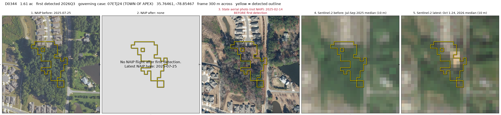

## D0305

1.8 acres · first detected 2026 Q4 · governing case: 25CZ18 (VERIDEA SD PLAN)

**Verdict: Cleared**. Reviewer's note: Cleared - marked based on #5. No sharp photo after the detection date. Judged from the October 2026 satellite image.

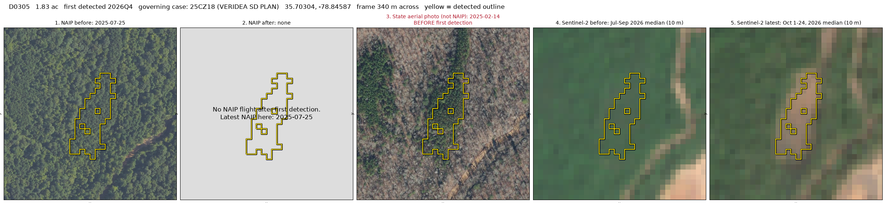

## D0450

1.2 acres · first detected 2026 Q4 · governing case: 25CZ18 (VERIDEA SD PLAN)

**Verdict: Cleared**. Reviewer's note: Cleared - marked based on #5. No sharp photo after the detection date. Judged from the October 2026 satellite image.

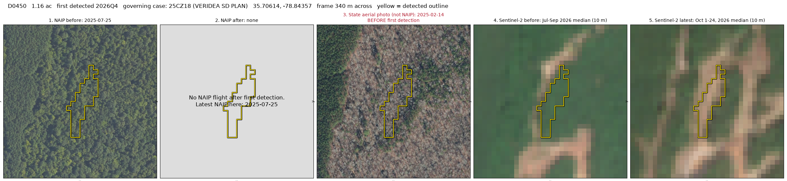

## D0480

1.1 acres · first detected 2026 Q4 · governing case: 11CZ13 ([private applicant])

**Verdict: Cleared**. Reviewer's note: Cleared - marked based on #5. No sharp photo after the detection date. Judged from the October 2026 satellite image.

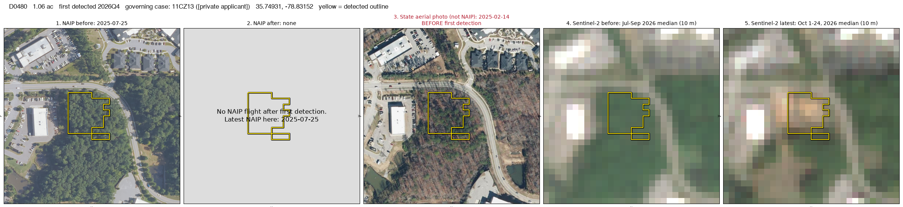

## D0357

1.6 acres · first detected 2026 Q4 · governing case: 07CZ01 (TRINITY PUD)

**Verdict: Cleared**. Reviewer's note: Cleared - marked based on #5. No sharp photo after the detection date. Judged from the October 2026 satellite image.

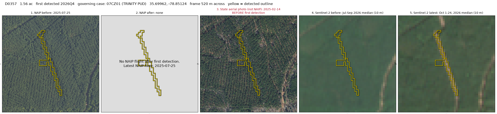

## D0329

1.7 acres · first detected 2026 Q3 · governing case: 17CZ18 (GRACEWOOD PUD)

**Verdict: Partly cleared** (about 85% of the outline cleared). Reviewer's note: Based on #5 it looks mostly cleared. but you can see some trees. calling it 85%

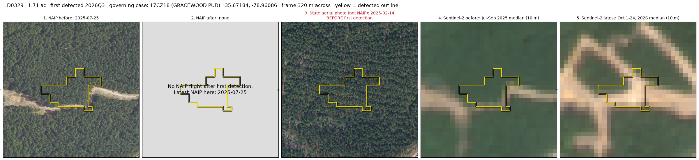

## D0214

2.6 acres · first detected 2026 Q2 · governing case: 24CZ09 (CASTLEBERRY RESE)

**Verdict: Cleared**. Reviewer's note: Cleared - marked based on #5. No sharp photo after the detection date. Judged from the October 2026 satellite image.

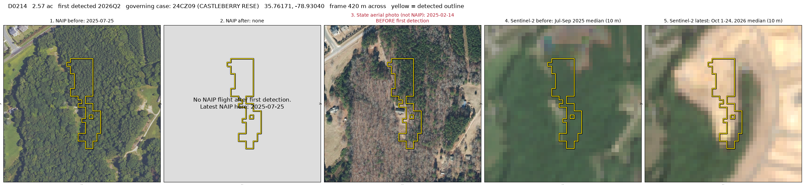

## D0238

2.3 acres · first detected 2026 Q1 · governing case: 25CZ18 (VERIDEA SD PLAN)

**Verdict: Cleared**. Reviewer's note: Cleared - marked based on #5. No sharp photo after the detection date. Judged from the October 2026 satellite image.

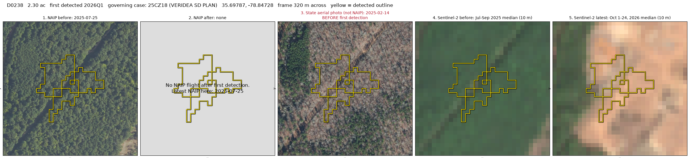

## D0464

1.1 acres · first detected 2026 Q1 · governing case: 25CZ18 (VERIDEA SD PLAN)

**Verdict: Partly cleared** (about 95% of the outline cleared). Reviewer's note: based on #3 it looks fully clear. mostly tree shadows in the boundaries. but maybe there are a few trees. calling it 95%

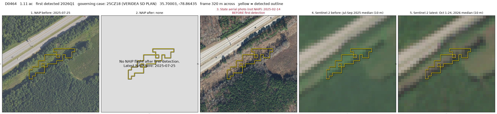

Page 5 of 5: [1](README.md) · [2](page-02.md) · [3](page-03.md) · [4](page-04.md) · **5**
